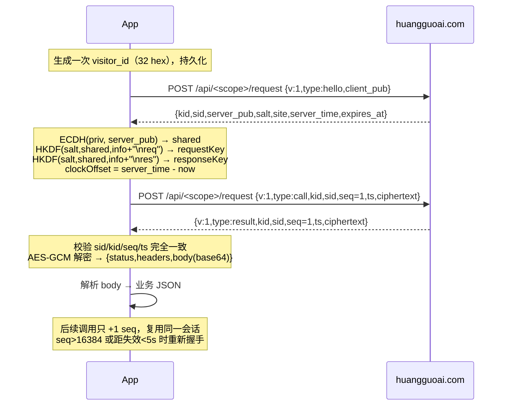
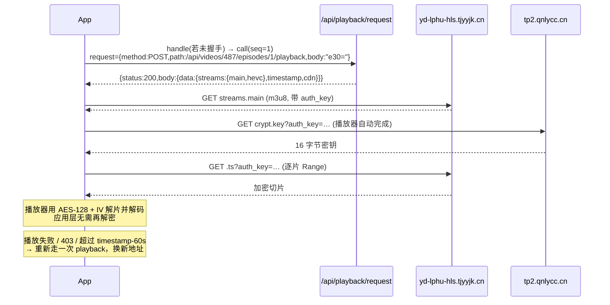
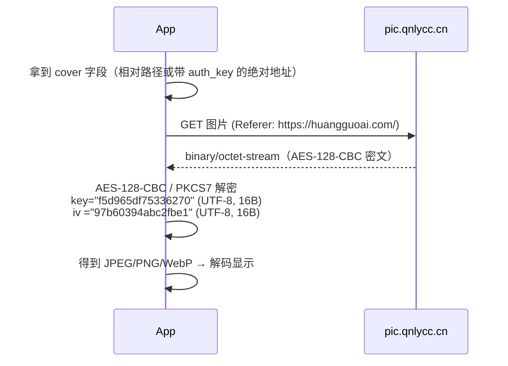

# 黄果短剧（huangguoai.com）接口与加密说明

> 面向自研客户端（Android / 桌面 / 脚本）的实现文档。
> 全部结论来自 2026-11 对站点实际请求的抓取与复现：报文是服务器真实输出，密钥派生与环境参数逐项核对过，
> 无法验证的部分在文末「未确认项」中单独列出。
>
> 参考实现在本仓库两处：`hg-plugin/src/edge-core.mjs`（HGhub 插件用的 JS 版）、
> `hg-plugin/dist/huangguo.js`（单文件产物，可直接对照字段映射）。

---

## 1. 站点结构

| 项 | 值 |
| --- | --- |
| 站点 | 黄果短剧，短剧 / AI 漫剧 / AI 换脸 / AI 魔改四类内容 |
| 主站 | `https://huangguoai.com`（另有 `huangguoai.ai`、`huangguo88.pages.dev` 等镜像） |
| 前端形态 | 服务端渲染 HTML（约 213 KB），RequireJS 模块，无 SPA 框架 |
| 边缘 | CloudFront（HKG）→ `nginx/1.22.1` |
| 图片 CDN | `pic.qnlycc.cn`，另有 `new.qnlycc.cn`、`image.qnlycc.cn`、`pic.aluxvl.cn`、`new2.qnlycc.cn` |
| 视频 CDN | `yd-lphu-hls.tjyyjk.cn`（播放列表/切片）、`tp2.qnlycc.cn`（AES-128 密钥） |
| 页面路由 | `/`、`/video/<id>/`、`/ranks/hot/`、`/topics/`、`/ai-duanju/`、`/ai-manju/`、`/original/`、`/search` 等 |

内容卡片与详情都从 `/api/*` 取，页面 HTML 只是渲染结果。

---

## 2. 接口总览与分类

站点把接口分四档，档位决定走哪个加密入口：

| 档位 | 入口 | 是否加密 | 典型接口 |
| --- | --- | --- | --- |
| `public` | `POST /api/public/request` | 是（但可不带登录态） | `/api/site/config`、`/api/home/latest`、`/api/search/hot`、`/api/site/categories/video`、`/api/ranks/:type` |
| `dynamic` | `POST /api/dynamic/request` | 是 | `/api/home`、`/api/videos/:id`、`/api/search?q=`、`/api/videos/:id/comments` |
| `playback` | `POST /api/playback/request` | 是 | `/api/videos/:id/episodes/:ep/playback` |
| `user` | `POST /api/user/request` | 是 + 需要 `Authorization` | `/api/account/*`、`/api/users/me/*`、点赞/收藏/评论 |

页面里 `window.__cloudfrontCompat` 直接列出了每条路由属于哪一档（`encryptedAPIRoutes.dynamic / playback / public / user`），要新增接口调用时先查这张表。

**明文接口仍可用**：带 `?` 的普通 GET（如 `/api/site/config`）直接返回 JSON，不需要走加密通道；加密只作用在 POST 的 `/api/<scope>/request` 上。所以最简单的只读场景可以先试明文，失效再上加密通道。

---

## 3. 加密通道 `dx150-edge-v1`

### 3.1 握手

```http
POST /api/<scope>/request
Content-Type: application/json

{"v":1,"type":"hello","client_pub":"<base64url(0x04||X||Y)>"}
```

`client_pub` 是 **65 字节未压缩 P-256 点**（首字节 `0x04`）的 base64url（无填充）。

响应：

```json
{"v":1,"type":"hello","kid":"v20261109","sid":"0ZlAuSEMdLakYigSPJXTUqGBdm8fvnxY",
 "server_pub":"BLNctg8ij38_…","salt":"zDSX7JwmeKG-iR16FWwAhPbP5I_P3b_1sT5XmmITh9s",
 "site":"huangguoai.com","expires_at":1795419784,"server_time":1795419184}
```

| 字段 | 含义 |
| --- | --- |
| `kid` | 密钥/协议版本标识，形如 `v20261109`，会随服务端轮换 |
| `sid` | 本次会话 id，32 字符（16 字节 base64url） |
| `server_pub` | 服务端临时 P-256 公钥（65 字节未压缩点） |
| `salt` | HKDF 的 salt，32 字节 |
| `site` | 站点主机名，参与密钥派生 |
| `server_time` / `expires_at` | 服务器秒级时间与失效时间，差值固定 **600 秒** |

客户端要校验：`expires_at > server_time` 且差值 ≤ 600，否则拒绝该会话。

### 3.2 密钥派生

```
shared   = ECDH(P-256, client_private, server_pub)      // 32 字节，取 X 坐标
info     = "dx150-edge-v1\n" + scope + "\n" + site + "\n" + kid + "\n" + sid
requestKey  = HKDF-SHA256(ikm=shared, salt=salt, info=info + "\nreq", length=32)
responseKey = HKDF-SHA256(ikm=shared, salt=salt, info=info + "\nres", length=32)
```

HKDF 为标准实现：`PRK = HMAC-SHA256(salt, ikm)`，`OKM = HMAC-SHA256(PRK, info || 0x01)`（取 32 字节）。

### 3.3 调用

```json
{"v":1,"type":"call","kid":"v20261109","sid":"0ZlAuSEM…","seq":1,"ts":1795419184,
 "ciphertext":"<base64url(AES-256-GCM 密文||标签)>"}
```

| 参数 | 规则 |
| --- | --- |
| `iv` | 12 字节：前 4 字节全 0 + 大端 `uint32(seq)` |
| `AAD` | `info + "\n" + "req" + "\n" + seq + "\n" + ts` |
| `seq` | 每通道从 1 递增，上限 **16384**，超限重握手 |
| `ts` | Unix 秒 = 本地时间 + (server_time − 本地握手时间) |

请求明文（加密前）是一个 JSON 信封：

```json
{"request":{"method":"POST","path":"/api/videos/487/episodes/1/playback",
            "body":"e30=","content_type":"application/json",
            "visitor_id":"fd2dedf60444d8bed14433eb81f419cd","channel_code":""}}
```

| 字段 | 说明 |
| --- | --- |
| `method` | HTTP 方法，原样描述目标接口 |
| `path` | 目标路径，**含查询串**（如 `/api/search?q=%E9%87%8D%E7%94%9F&page=2`） |
| `body` | 目标接口请求体的 **标准 base64（带填充）**；无请求体时为空串。`{}` → `"e30="` |
| `content_type` | 有请求体时 `application/json`，否则空串 |
| `visitor_id` | 32 位十六进制访客标识，客户端自行生成并持久化 |
| `channel_code` | 渠道码，普通客户端留空 |

`user` 通道会额外带 `"authorization":"Bearer <token>"`。

### 3.4 解密响应

```json
{"v":1,"type":"result","kid":"v20261109","sid":"0ZlAuSEM…","seq":1,"ts":1795419184,
 "ciphertext":"<base64url>"}
```

必须逐项核对 `sid` / `kid` / `seq` / `ts` 与请求一致，否则按「响应不匹配」丢弃。
解密用 `AAD = info + "\nres\n" + seq + "\n" + ts`、同一把 `iv`。

明文是一个被包装过的完整 HTTP 响应：

```json
{"status":200,
 "headers":{"content-type":["application/json; charset=utf-8"],
            "x-edge-visitor":["fd2dedf6…"],"x-hg-visitor":["fd2dedf6…"]},
 "body":"<base64(真实响应体)>"}
```

也就是说客户端拿到的是「状态码 + 响应头 + base64 响应体」，解出来再按普通 JSON 处理。

### 3.5 会话管理

| 规则 | 做法 |
| --- | --- |
| 复用 | 距失效 > 5 秒且 `seq < 16384` 时复用，否则重新握手 |
| 并发 | 同一通道只保留一个在途握手，其余请求等待它完成 |
| 过期 | 服务端可能返回 4xx + `session_expired`，此时丢弃该通道会话并重试一次 |
| 时钟 | 用 `server_time` 校正，避免本地时间偏差导致 `ts` 被拒 |

实测同一页面加载会产生：`playback` 通道 1 次握手 + 1 次 call，`user` 通道 1 次握手 + 2 次 call，`dynamic` 通道按需。

---

## 4. 图片加密（封面 / 头像 / 横幅）

站点把图片在 CDN 上以 **AES-128-CBC** 密文存放，密钥写在前端公开文件
`/static/web/js/plugins/crypto-image-protocol.js` 里：

```js
window.CryptoImageProtocol = {"decryptEnabled": true,
  "decryptKey": "f5d965df75336270",   // 16 字节 ASCII，作 AES-128 key
  "decryptIV":  "97b60394abc2fbe1"}   // 16 字节 ASCII，作 CBC IV
```

| 项 | 值 |
| --- | --- |
| 算法 | AES-128-CBC |
| key / iv | 上面两个字符串按 **UTF-8 编码后的 16 字节**直接使用（不是十六进制解码） |
| 填充 | PKCS#7（实测密文尾部有 9 字节 `0x09` 填充；浏览器端用 NoPadding 也能显示，因为解码器忽略尾部多余字节） |
| 传输 | CDN 返回 `binary/octet-stream`，`Referer: https://huangguoai.com/` |

解密后是标准 JPEG / PNG / WebP（实测封面、横幅、头像三张均为 JPEG，`FF D8 FF E0` 开头）。

**地址形式**：

```
https://pic.qnlycc.cn/upload_01/upload/20260810/2026081021575876142.jpg?auth_key=1795426912-0-0-<md5>
```

- 接口有时给相对路径（`/upload_01/...`），拼上 `https://pic.qnlycc.cn` 即可；有时直接给带 `auth_key` 的绝对地址。
- `auth_key` 是七牛式签名：`<过期时间戳>-<app>.<版本>.<渠道>-<随机/0>-<md5>`，时效短；接口每次下发新的签名，客户端不要缓存带签名的 URL 过久。
- 实测不带 `auth_key` 的路径同样返回 200，所以签名不是硬门槛。

**Android 落地**：图片加载器（Coil/Glide）加一个拦截器/自定义 fetcher——先拿原始字节，用 `Cipher.getInstance("AES/CBC/PKCS5Padding")` 解一次，再把明文交给解码器；请求头补 `Referer`。

---

## 5. 播放

### 5.1 取播放地址

```json
{"request":{"method":"POST","path":"/api/videos/487/episodes/1/playback",
            "body":"e30=","content_type":"application/json","visitor_id":"…","channel_code":""}}
```

走 **playback** 通道。返回（解密后的 `body`）：

```json
{"data":{
  "mode":1,"timestamp":1795426800,"manifest_method":"GET",
  "cdn":{"m3u8Enabled":true,"otherEnabled":false,
         "authKey":"x-cdn-auth","authValue":"4aae16c3b20ec822f87518504478bb35",
         "app":"150","imgEnabled":false,
         "imgAuthKey":"x-cdn-auth","imgAuthValue":"b58c4e6ff6583177f8f85f1a22e8fc01"},
  "id":"487","ep":1,"media_id":"",
  "streams":{
    "main":"https://yd-lphu-hls.tjyyjk.cn/videos5/<hash>/<hash>.m3u8?auth_key=…&v=3&time=0&via=dx150&via_bm=dx",
    "hevc":"https://yd-lphu-hls.tjyyjk.cn/m3m/<长 hash>.m3u8?auth_key=…",
    "preview":"（与 main 相同）"}},
 "status":1,"msg":"","req_time":1795419331}
```

| 字段 | 说明 |
| --- | --- |
| `streams.main` | H.264 HLS 播放列表 |
| `streams.hevc` | H.265 播放列表（体积小、码率低，需解码端支持） |
| `streams.preview` | 预览/试看地址，通常与 main 相同 |
| `timestamp` | 过期时间（秒），`main` 里的 `auth_key` 与之对应 |
| `cdn.authKey/authValue` | 声明访问 CDN 时要带的请求头。**实测不带该头 m3u8 仍返回 200**，当前配置未强制 |
| `manifest_method` | 取播放列表的方法，实测为 `GET` |

### 5.2 播放列表本身

```
#EXTM3U
#EXT-X-VERSION:3
#EXT-X-KEY:METHOD=AES-128,URI="https://tp2.qnlycc.cn/videos5/<hash>/crypt.key?auth_key=…",IV=0x5be54836…
#EXT-X-MEDIA-SEQUENCE:0
#EXT-X-TARGETDURATION:6
#EXTINF:5.200,
https://tp2.qnlycc.cn/videos5/<hash>/<hash>10.ts?auth_key=…
```

- 切片是 **HLS 标准 AES-128 加密**：密钥单独给出（`crypt.key`），IV 在播放列表里。播放器（ExoPlayer/Media3 的 HLS 模块）原生支持，**不需要自己解密媒体**。
- 应用层没有二次加密：`streams.*` 直接可播。
- 播放列表与切片域不同（`yd-lphu-hls.tjyyjk.cn` 出列表、`tp2.qnlycc.cn` 出密钥/切片），都带 `auth_key` 签名。

### 5.3 地址时效与刷新

签名/过期时间短（`auth_key` 里的 deadline 与 `timestamp` 同一量级，分钟级到小时级）。
客户端应在以下时机重新调用 playback 接口，而不是复用旧地址：

- 播放失败 / 403 / 401
- 播放超过 `expiresAt − 60s`
- 切换集数、切换线路

实测过期几分钟的地址仍可能命中 CDN 缓存返回 200，但这属于缓存行为，不能依赖。

---

## 6. 搜索

```json
{"request":{"method":"GET","path":"/api/search?q=%E9%87%8D%E7%94%9F&page=1", …}}
```

走 **dynamic** 通道。参数：

| 参数 | 说明 |
| --- | --- |
| `q` | 关键词（URL 编码，UTF-8），必填；缺失时返回 `{"data":[],"status":0,"msg":"请输入搜索关键词"}` |
| `page` | 页码，从 1 开始 |

返回：

```json
{"data":{"engine":"vector","keyword":"重生","type":"","items":[ … ],
 "pagination":{"page":1,"pages":5,"size":20,"total":96}},"status":1,...}
```

- 每页 20 条，`pages` 是总页数，`total` 是总数。
- `engine: "vector"` 说明是向量检索（相关度排序，不是纯字面匹配）。

**热搜**：`GET /api/search/hot`，**public** 通道，返回：

```json
{"data":{"items":[{"heat":4683,"word":"存在感"},{"heat":4259,"word":"妈妈"}]}}
```

**输入联想**：`/api/search/suggest`、`/api/search/tags/hot`（同为 public 档，未逐一验证字段）。

---

## 7. 首页、分类与详情

### 7.1 首页 `GET /api/home`（dynamic）

```json
{"data":{
  "banners":[{"id":28,"title":"","video_id":10586,"image":"/upload_01/…jpeg","score":9.4,"desc":"…"}],
  "featured":[{"id":12,"title":"神瞳觉醒 第一季","cover":"/upload_01/…jpg","hot":64390,"score":9.1,
               "tags":["…"],"episode_count":20,"is_finished":true,"cate_id":"24"}],
  "latest":[ 同上结构 ],
  "cate_rec":[{"cate_id":24,"cate_name":"短剧","videos":[ {卡片} ]}],
  "topic_rec":[{"id":3,"title":"…","slug":"…","cover":"…","video_count":12}]
}}
```

### 7.2 最近更新（可翻页）`GET /api/home/latest?page=1`（public）

```json
{"data":{"items":[ {卡片} ],"total":1234,"page":1,"size":20}}
```

卡片字段（首页/列表通用）：
`id, title, cover, hot, duration(秒，字符串), cate_id, is_adult, play_at, score, tags[], desc, badge, is_hot, episode_count, is_finished`。

### 7.3 分类 `GET /api/site/categories/video`（public）

```json
{"data":{"items":[
  {"id":27,"index":1,"name":"AI魔改","route":"ai-mogai","sort":910},
  {"id":24,"index":1,"name":"短剧","route":"ai-duanju","sort":940}]}}
```

对应页面路由 `/ai-duanju/`、`/ai-manju/`、`/ai-huanlian/`、`/ai-mogai/`。

### 7.4 详情 `GET /api/videos/:id`（dynamic）

```json
{"data":{
  "id":487,"title":"驱魔司主理人","description":"…","cover":"https://pic.qnlycc.cn/…jpg?auth_key=…",
  "score":8.9,"duration":"344","episode_count":10,"total_episodes":10,
  "is_finished":true,"created_at":"2026-08-10 21:58:16",
  "tags":["玄幻","奇幻","灵异"],
  "counts":{"collect":8473,"comment":297,"hot":799639,"like":3610},
  "author":{"id":156291,"name":"黄果官方","avatar":"…"},
  "episodes":[{"ep_num":1,"title":"第1集","duration":344,"status":1}, …],
  "interaction":{"collected":false,"liked":false,"liked_ep":1},
  "breadcrumb":[{"name":"漫剧","url":"/ai-manju/"}]}}
```

- `episodes[].ep_num` 就是分集号，直接作为 `episodeId` 拼进 playback 路径。
- `status: 1` 表示可播；非 1 视为锁定。
- `/video/<n>/` 里的 `n` 就是这里的 `id`（实测 `/api/videos/14454` 正常返回作品）。
- 详情里另有 `video_type / video_url / video_key / video_iv / video_api` 字段，属于旧播放通道，新接口未使用。

---

### 7.5 榜单（排行榜）

三个榜单页 `/ranks/hot/`、`/ranks/recommend/`、`/ranks/potential/` 对应同一个接口：

```
GET /api/ranks/{type}        type ∈ hot | recommend | potential
```

**档位：public**。可以走 `/api/public/request` 加密通道，也可以直接明文 GET（实测两者返回一致）。
**不要走 dynamic 通道**——实测 `/api/dynamic/request` 下的 `/api/ranks/hot` 返回 `400 {"error":"请求无法处理"}`。

返回（明文，已截断）：

```json
{"data":{"type":"hot","items":[
  {"rank":1,"video_id":117,"title":"高三爱情故事",
   "cover":"https://pic.qnlycc.cn/upload_01/…jpg?auth_key=1795428393-0-0-…",
   "cate_name":"短剧","episode_count":48,"is_finished":false,"intervened":false,
   "score":9.6,"tags":["现代","校园","同学"],
   "metric_label":"热力指数","metric_value":6589,
   "metrics":{"play":43217681,"like":43380,"collect":12087,"comment":2817}},
  {"rank":2,"video_id":…}
]},"status":1,"msg":"","req_time":1795428393}
```

| 字段 | 类型 | 说明 |
| --- | --- | --- |
| `data.type` | String | 回显请求的榜单类型 |
| `items` | Array | **固定 20 条**，`rank` 从 1 到 20 |
| `rank` | Int | 名次，直接用于展示；也是服务端排序依据 |
| `video_id` | Int | 作品 id，等价于详情接口 `/api/videos/{video_id}` |
| `title` | String | 标题（无首尾空格） |
| `cover` | String | 带 `auth_key` 的绝对地址，**仍是 AES-128-CBC 密文**，见第 4 节 |
| `cate_name` | String | 分类中文名：`短剧` / `漫剧` |
| `episode_count` | Int | 已更新集数 |
| `is_finished` | Bool | 是否完结 |
| `intervened` | Bool | 布尔标记，含义未确认（疑似人工干预位） |
| `score` | Double | 评分 0–10 |
| `tags` | String[] | 标签 |
| `metric_label` | String | 该榜单的指标名：热播榜 `热力指数`、推荐榜 `推荐指数`、潜力榜 `潜力指数` |
| `metric_value` | Int | 该指标数值，榜单按它排序 |
| `metrics.play` | Long | 播放量 |
| `metrics.like` | Long | 点赞数 |
| `metrics.collect` | Long | 收藏数 |
| `metrics.comment` | Long | 评论数 |

**参数**：没有分页，也没有筛选。

| 尝试 | 结果 |
| --- | --- |
| `?page=2` | 忽略，仍返回同一批 20 条 |
| `?cate=24` / `?cate_id=24` | 忽略 |
| `?limit=5` / `?size=5` | 忽略 |
| `type` 为 `new` / `score` / `collect` / `week` / `month` | `200` + `{"data":[],"status":0,"msg":"榜单不存在"}` |

注意这里"榜单不存在"是 **HTTP 200 + 业务 status 0**，不是 4xx，客户端要按 `status` 判断。

**页面兜底**：`/ranks/<type>/` 的 SSR HTML 里已经内联了 TOP20 列表（可直接从 `/video/<id>/` 链接取 id 与标题），接口挂了还能降级抓页面。

**接入建议**：榜单适合做首页的一个 `row` 分区或分类页的固定分类，卡片用 `video_id` 作为条目 id、`rank` 作为角标（如 `#1`）；榜单条目**不带** `desc`/`duration`，列表模型里这两个字段必须可空。

### 7.6 专题（`/topics/`）

专题是"人工编排的作品合集"，页面 `/topics/` 是列表，`/topics/<slug>/` 是单个专题。
两个接口都属于 **public 档**：走 `/api/public/request` 加密通道或直接明文 GET 均可，**不能走 dynamic**（实测 `400 {"error":"请求无法处理"}`）。

#### 列表

```
GET /api/topics?page=N
```

```json
{"data":{
  "items":[{"id":12,"title":"精品高分AI短剧专辑","slug":"hot-aiduanju",
            "cover":"https://pic.qnlycc.cn/…jpg?auth_key=…",
            "intro":"精品高分 AI 成人短剧专题，精选高人气、高评分 AI 原创短剧，每日持续更新。…",
            "video_count":81}],
  "pagination":{"page":1,"pages":2,"size":9,"total":11}}}
```

| 字段 | 类型 | 说明 |
| --- | --- | --- |
| `items[].id` | Int | 专题 id，仅用于展示/去重，接口路径用 `slug` |
| `items[].title` | String | 专题名，如「精品高分AI短剧专辑」 |
| `items[].slug` | String | **路由键**，拼进 `/api/topics/{slug}` 与 `/topics/{slug}/` |
| `items[].cover` | String | 专题封面，AES-128-CBC 密文，带 `auth_key` |
| `items[].intro` | String | 专题简介，长文本（可达数百字） |
| `items[].video_count` | Int | 收录作品数 |
| `pagination.size` | Int | **每页条数（这里是 9）**，不是"本页条数" |
| `pagination.pages` / `total` | Int | 总页数 / 总条数；当前共 11 个专题、2 页 |

`page` 超出范围时返回空 `items`（`pages` 仍为真实值），不会 4xx。

**slug 有坑**：现存 slug 里既有 `AImori-chongsheng`（含大写）也有 `xiaoyuan—qingcun`（含全角破折号 `—`，不是 ASCII 的 `-`）。
拼路径时必须 `encodeURIComponent(slug)` 原样使用，**不要** lower-case 或把 `—` 换成 `-`，否则 404。

当前 11 个 slug：

```
hot-aiduanju, luanlun-aiduanju, paranormal-aiduanju, xiaoyuan—qingcun,
AImori-chongsheng, baihe-nvtong, xiangcun-AIchengren, gufen-wuxiachuanyue,
xianxia-qihuanyaoxiai, tiancai-nantong, oumei-duanju
```

#### 详情

```
GET /api/topics/{slug}?page=N
```

```json
{"data":{
  "topic":{"id":12,"title":"精品高分AI短剧专辑","slug":"hot-aiduanju","cover":"…","intro":"…",
           "video_count":81,
           "faq":[{"q":"精品高分AI成人短剧多久更新一次？","a":"本专题会持续收录…"}],
           "search_text":"…"},
  "videos":{"items":[{"id":12,"title":"神瞳觉醒 第一季","cover":"…","hot":64494869,"duration":"207",
                      "score":9.6,"episode_count":21,"total_episodes":21,"is_original":1,"is_hot":1,
                      "description":"…"}],
            "pagination":{"page":1,"pages":5,"size":20,"total":81}},
  "related":[{"id":17,"title":"灵异诡事AI短剧专辑","slug":"paranormal-aiduanju","cover":"…","intro":"…","video_count":13}, …]}}
```

| 字段 | 类型 | 说明 |
| --- | --- | --- |
| `topic` | Object | 专题本身：`id / title / slug / cover / intro / video_count` |
| `topic.faq` | Array | `{q, a}[]`，SEO 问答，可直接渲染成折叠面板 |
| `topic.search_text` | String | 给搜索用的纯文本摘要，展示时一般忽略 |
| `videos.items[]` | Array | 作品卡片，字段与首页/搜索卡片一致（`id` 就是 `video_id`） |
| `videos.pagination` | Object | 每页 **20** 条，`pages` 与 `total` 为该专题作品总数 |
| `related[]` | Array | 其它 4 个专题，字段同列表条目，可做「相关专题」 |

`videos` 详情页是**分页的**：`/topics/hot-aiduanju` 共 81 条 / 5 页，`?page=2` 返回第 21–40 条。
翻页时只换 `page`，slug 不变；越界同样返回空 `items`。

#### 接入建议

| 形态 | 做法 |
| --- | --- |
| 首页分区 | 把 `/api/topics?page=1` 的 9 个专题做成一个 `grid`，封面用 `cover`，标题用 `title` |
| 分类/专题页 | 专题详情页：头部 `topic.title + intro`，下面 `videos.items` 做无限滚动（滚到底 `page+1`），底部 `related` 横滑 |
| 搜索 | 专题名可以参与本地搜索；`topic.search_text` 不适合展示 |

#### 与首页 `topic_rec` 的关系

`/api/home` 里的 `topic_rec` 是同一批专题的**首页推荐子集**（约 3 个，字段 `id/title/slug/cover/intro/video_count`），
比 `/api/topics` 少但一致；要完整列表就用 `/api/topics`，别指望首页字段里带全。

### 7.7 分类、原创与排序

#### 7.7.1 分类页（`/ai-duanju/`、`/ai-manju/`、`/ai-mogai/`、`/ai-huanlian/`）

```
GET /api/videos/category/{route}?page=1&size=20
```

**public 档**（明文也可，dynamic 档 400）。`route` 取自 `/api/site/categories/video`：

| route | 名称 | 页面 | 实测总量 |
| --- | --- | --- | --- |
| `ai-duanju` | 短剧 | `/ai-duanju/` | 1742 条 / 88 页（size=20） |
| `ai-manju` | 漫剧 | `/ai-manju/` | 120 条 / 6 页 |
| `ai-huanlian` | AI换脸 | `/ai-huanlian/` | 未测 |
| `ai-mogai` | AI魔改 | `/ai-mogai/` | 未测 |

```json
{"data":{"items":[{"id":117,"title":"高三爱情故事","cover":"https://pic.qnlycc.cn/…?auth_key=…",
                   "hot":43217681,"duration":"241","score":9.6,"episode_count":48,
                   "is_original":0,"is_finished":false,"tags":["现代","校园","同学"], …}],
         "pagination":{"page":1,"pages":88,"size":20,"total":1742}}}
```

| 参数 | 说明 |
| --- | --- |
| `page` | 从 1 开始；越界返回空 `items`，HTTP 仍 200 |
| `size` | **生效**，默认 20；`size=12` → `pages` 变 146。上限未测 |
| 其他 | `sort`/`category` 等参数被忽略 |

条目字段与首页卡片一致（`id` 即 `video_id`）。页面分页器只渲染局部窗口（`/ai-duanju/` 最多显示到第 42 个链接），**以接口的** `pages` **为准**，不要按页面链接数推算总页数。

#### 7.7.2 原创页（`/original/`）

没有独立的 `/api/original` 或 `category/original`。原创是**视频列表的过滤条件**：

```
GET /api/videos?is_original=1&page=1&size=20      → 264 条 / 14 页
```

| 参数 | 结果 |
| --- | --- |
| `is_original=1` | 264 条（真正的原创子集） |
| `original=1` | 忽略，返回全量 1862 条 |
| `category=original` | 忽略，返回全量 1862 条 |
| `size` | 同分类接口，`size=12` → 22 页 |

`/api/videos`（不带过滤）就是全站作品列表：1862 条 / 94 页（size=20），条目带 `is_original`、`author`、`actors`、`like_count`、`collect_count`、`comment_count`、`total_collect`、`last_ep_at`、`new_at` 等更全的字段。

#### 7.7.3 排序

```
GET /api/videos/sort/{route}?page=1&size=20
```

`route` 取自 `/api/site/sorts/video`：

| route | 名称 | `sort` 值 | 实测行为 |
| --- | --- | --- | --- |
| `new` | 最近更新 | 111 | **顺序确实变化**，首条是刚更新的作品 |
| `popular` | 当前最热 | 222 | 与默认列表顺序一致 |
| `watchings` | 正在播放 | 100 | 与默认列表顺序一致 |
| `xiaolan` | 小蓝原创 | 97 | 与默认列表顺序一致 |

四者的 `total` 都是 1862——**sort 只排序不筛选**。除 `new` 之外三个在未登录态下与默认顺序相同，
可能是因为排序依赖行为数据（观看/播放统计），或是上游未启用；重试无益，先按 `new` 可用处理。

### 7.8 图文（`/blog/*`、`/archives/*`）

站点的图文板块：列表页 `/blog/gossip/`、`/blog/reviews/`，正文页 `/archives/{id}/`。

#### 7.8.1 分类与 URL 的映射（有坑）

页面 slug **不等于**接口 route：

| 页面               | 标题   | API `route`     | 篇数  |
| ---------------- | ---- | --------------- | --- |
| `/blog/gossip/`  | 热门吃瓜 | `remen-chigua`  | 453 |
| `/blog/reviews/` | 短剧剧评 | `ai-yuanchuang` | 368 |

`/api/posts/category/gossip`、`/api/posts/category/reviews` 都会返回
`{"data":[],"status":0,"msg":"分类不存在"}`（HTTP 200）。映射表来自
`GET /api/site/categories/post`：

```json
{"data":{"items":[
  {"id":9002,"name":"热门吃瓜","route":"remen-chigua","intro":"","sort":999},
  {"id":9001,"name":"AI原创","route":"ai-yuanchuang","intro":"","sort":900}]}}
```

注意 `ai-yuanchuang` 的显示名是「AI原创」，但它的页面是 `/blog/reviews/`（短剧剧评），不要按名字猜。

#### 7.8.2 列表

```
GET /api/posts/category/{route}?page=1&size=20
```

**public 档**（dynamic 档 400）。`size` 生效；站点页面实际用 `size=12`（453 条 → 38 页）。

```json
{"data":{"items":[{"id":65,"title":"抖音女神 聂小雨 直播事故 …","cover":"https://pic.qnlycc.cn/…?auth_key=…",
                   "desc":"","hot":71149,"tags":["抖音网红","黑料","露点", …],
                   "created_at":"2026-08-13 17:08:00","publish_time":"2026-08-14 01:07:59"}],
         "pagination":{"page":1,"pages":23,"size":20,"total":453}}}
```

| 字段 | 类型 | 说明 |
| --- | --- | --- |
| `id` | Int | 图文 id，对应 `/api/posts/{id}` 与 `/archives/{id}/` |
| `title` | String | 标题，长且含关键词堆砌，展示时建议截断 |
| `cover` | String | 封面，AES-CBC 密文 |
| `desc` | String | 摘要，实测多为空串 |
| `hot` | Long | 热度 |
| `tags` | String[] | 标签，条数多（10+），建议只展示前 3–5 个 |
| `created_at` / `publish_time` | String | `yyyy-MM-dd HH:mm:ss` |

另有 `GET /api/posts?page=1`（全站图文，825 条 / 42 页），字段与上表相同。

#### 7.8.3 正文

```
GET /api/posts/{id}
```

**dynamic 档**——同一模块里唯独这条接口必须走加密通道（public 档直接 `400 {"error":"请求无法处理"}`）。

```json
{"data":{
  "id":1159,"title":"黄果短剧《千金小姐爱上匪》…","desc":"…","cover":"…",
  "content":"<p>…</p>…",
  "author":{"id":…,"name":"…","avatar":"…"},
  "counts":{"collect":…,"comment":…,"hot":…,"like":…},
  "interaction":{"collected":false,"liked":false},
  "tags":["…"],"tag_links":[{"name":"…","url":"/tag/…/"}],
  "created_at":"2026-…","publish_time":"2026-…",
  "video_url":"","video_key":"","video_iv":"","video_api":""}}
```

| 字段 | 说明 |
| --- | --- |
| `content` | 正文 **HTML**，含 `<p>`、``；渲染前必须清洗 |
| `content` 里的图片 | 用 `data-src` 存真实地址，`src` 是指向 `cover-placeholder.png` 的占位图；需取 `data-src` 后按第 4 节解密 |
| `author` | 与视频详情同结构 |
| `counts` | 展示用计数 |
| `video_url` / `video_key` / `video_iv` / `video_api` | 旧版内嵌视频通道字段，实测为空串，不要依赖 |

**正文图片处理顺序**：解析 HTML → 取 `img[data-src]` → 下载（带 `Referer`）→ AES-128-CBC 解密 → 替换 `src` 为本地/内存图片。
不要直接把 `data-src` 交给图片加载器，会拿到密文。

#### 7.8.4 接入建议

| 形态 | 做法 |
| --- | --- |
| 图文列表 | `catalog` 或首页 `list` 分区：封面 + 标题（截断到 40 字）+ 标签前 3 个 |
| 图文详情 | 正文 `content` 走宿主/客户端清洗后渲染；图片按上面的顺序解密；`related` 用 `/api/posts/{id}/adjacent` 或 `/api/posts/{id}/related`（未验证字段） |
| 与视频联动 | 图文里常内嵌 `/video/{id}/` 链接，点击可直接跳视频详情 |

### 7.9 个人中心（`/profile/`）

`/profile/` 是登录 + 个人中心的壳：未登录展示登录表单，登录后展示收藏 / 历史 / 点赞 / 关注 / 消息。
页面本身不返回数据，全部走下面这些接口。

#### 7.9.1 档位与未登录行为

| 接口 | 档位 | 未登录 |
| --- | --- | --- |
| `GET /api/account/me` | user | **内层 401** |
| `GET /api/users/me/collects?page=` | user | 内层 401 |
| `GET /api/users/me/history?page=` | user | 内层 401 |
| `GET /api/users/me/likes?page=` | user | 内层 401 |
| `GET /api/users/me/follows?page=` | user | 内层 401 |
| `GET /api/users/me/comments?page=` | user | 内层 401 |
| `GET /api/users/me/messages?page=` | user | 内层 401 |
| `GET /api/users/me/messages/unread-count` | user | 内层 401 |
| `POST /api/account/loginByPassword` | user | 见 7.9.4 |
| `POST /api/account/registerByPassword` | user | 未验证 |
| `POST /api/account/logout` / `password` / `profile` | user | 未验证 |
| `GET /api/users/:id`（他人主页） | **dynamic** | 公开可读 |
| `GET /api/users/:id/stats` | **public** | 公开可读 |
| `POST /api/users/:id/follow` | user | 内层 401 |
| `GET /api/whoami` | **dynamic** | 公开可读 |

**未登录响应的关键**：外层 HTTP 仍是 `200`，加密信封正常解开，内层是

```json
{"data":[],"status":0,"msg":"unauthorized"}     // 内层 status = 401
```

客户端必须用**内层** `status` 判定登录态，不能看 HTTP 码。业务失败同理：`status:0` + 中文 `msg`，
例如 `分类不存在`、`请输入账号和密码`、`榜单不存在`。

`/api/whoami` 不属于 public 档（public 会 `400 {"error":"请求无法处理"}`），但**明文 GET 可用**；
返回 `{ip, country}`，只说明出口 IP，别当登录态探测。

#### 7.9.2 用户主页 `GET /api/users/:id`（dynamic）

```json
{"data":{"id":156291,"username":"author_156291","nickname":"黄果官方",
         "avatar":"https://pic.qnlycc.cn/…jpg?auth_key=…","avatar_color":"#56C4A7",
         "sign":"看剧就上黄果短剧","desc":"","user_type":"normal","channel_code":"",
         "counts":{"collect":…,"follower":…,"following":…,"like":…,"post":…,"video":…}},
 "status":1,"msg":"","req_time":…}
```

| 字段 | 类型 | 说明 |
| --- | --- | --- |
| `id` | Int | 用户 id，用于 `/api/users/{id}/stats`、`follow` |
| `username` | String | 登录名形态（如 `author_156291`） |
| `nickname` | String | 展示名 |
| `avatar` | String | 头像，AES-CBC 密文 |
| `avatar_color` | String | 头像占位色（`#RRGGBB`），解码前可先显示 |
| `sign` / `desc` | String | 签名 / 简介，可能为空串 |
| `user_type` | String | 实测 `normal`，其它取值未知 |
| `counts` | Object | `collect / follower / following / like / post / video` 六个计数 |
| `channel_code` | String | 渠道码，一般空 |

详情页 `author` 字段（见 7.4）是这个结构的简化版。

#### 7.9.3 用户统计 `GET /api/users/:id/stats`（public）

```json
{"data":{"user_id":156291,"like_count":4149800,"following":0,
         "followers":11486,"video_count":1741,"post_count":1},"status":1}
```

适合在列表里批量取作者数据时用：**这条是 public 档**，`/api/users/:id` 则是 dynamic 档，
只要计数就不要走加密通道。

#### 7.9.4 登录（已实测）

```http
POST /api/account/loginByPassword
Content-Type: application/json

{"username":"<账号>","password":"<密码>"}
```

字段名就是 `username` / `password`（前端 `hg-auth-modal.js` 里的表单即 `input[name=username]` / `[name=password]`）。
注册多一个 `confirm_password`，走 `POST /api/account/registerByPassword`。

成功响应：

```json
{"data":{"token":"<32 字符>","user":{"id":360532,"username":"demo_user","nickname":"demo_user",
        "avatar":"","avatar_color":"#C25B4E","sign":"","desc":"","user_type":"normal","channel_code":"",
        "counts":{"like":0,"collect":0,"following":0,"comment":0,"history":2}}},
 "status":1,"msg":"","req_time":…}
```

| 观察        | 结论                                                                  |
| --------- | ------------------------------------------------------------------- |
| HTTP 状态   | 恒 `200`，成败看内层 `status` / `msg`                                      |
| 凭据下发      | **响应体里的** `data.token`，长度 32；`Set-Cookie` 为 0 条                     |
| 后续怎么带     | 加密信封明文里的 `"authorization": "Bearer <token>"`（见 3.3）——**不需要 Cookie** |
| 失败响应      | `{"data":[],"status":0,"msg":"请输入账号和密码"}`（空字段）等，`status:0` 即失败      |
| `user` 结构 | 与 `GET /api/users/{id}` 相同                                          |

令牌直接放在加密信封里，所以抓包看不到；也别把它写进日志。

#### 7.9.5 登录态数据（已实测）

带 `authorization: Bearer <token>` 之后，下面这些都是 `status:1` 正常返回：

`GET /api/account/me`

```json
{"data":{"id":360532,"user_type":"normal","channel_code":"","nickname":"demo_user",
         "username":"demo_user","avatar":"","avatar_color":"#C25B4E","sign":"","desc":"",
         "counts":{"like":0,"collect":0,"following":0,"comment":0,"history":2},
         "interactions":{"like_video_ids":[],"favorite_video_ids":[],"like_post_ids":[],
                         "favorite_post_ids":[],"follow_user_ids":[],"like_video_episodes":[]}}}
```

`interactions` 是**点赞/收藏/关注的 id 数组**，可用它一次性把本地 UI 的选中态对齐，不必逐个查询。

**列表接口**（都返回 `{items, pagination}`，`size` 生效、默认 20）

| 接口 | 内容 | 实测 |
| --- | --- | --- |
| `GET /api/users/me/collects?page=&size=` | 云端收藏 | 空账号 0 条 |
| `GET /api/users/me/history?page=&size=` | 观看历史 | 2 条 |
| `GET /api/users/me/likes?page=&size=` | 点赞 | 0 条 |
| `GET /api/users/me/follows?page=&size=` | 关注 | 0 条 |
| `GET /api/users/me/comments?page=&size=` | 我的评论 | 0 条 |
| `GET /api/users/me/messages?page=&size=` | 站内消息 | 0 条 |
| `GET /api/users/me/messages/unread-count` | 未读数 | `{"unread":0}` |

历史条目（实测结构）：

```json
{"id":22520651,"video_id":15165,"title":"魔力手机","cover":"https://pic.qnlycc.cn/…?auth_key=…",
 "cate_id":24,"category_name":"短剧","episode_count":1,"total_ep":1,"total_episodes":0,
 "last_ep":1,"target_type":"video","updated_at":"2026-11-23 15:52:43","url":"/video/15165/"}
```

| 字段 | 说明 |
| --- | --- |
| `id` | 历史记录 id（不是作品 id），删除历史时用它 |
| `video_id` | 作品 id，等价于 `/api/videos/{id}` |
| `last_ep` | 最近观看的集号，用于续播 |
| `total_ep` / `total_episodes` | 已更新 / 总集数，后者常为 0 |
| `target_type` | `video`，其它取值未知 |
| `url` | 站内路径，可映射回 `video_id` |

收藏 / 点赞 / 关注 / 评论 / 消息在测试账号里都是空数组，**条目结构未验证**（只知道外层 `{items,pagination}`）。

**登录后互动接口**（`user` 档，`GET /api/videos/{id}/interaction-state?ep=1`）：

```json
{"data":{"ep":1,"guest_liked":{"liked":false,"likes":3610,"ep_likes":870,"ep":1,"collects":8473},
         "rating":{"score":"8.9","rating_cnt":1,"my":0}}}
```

比未登录多了 `rating.my`（自己打的分）。

#### 7.9.6 写操作（已实测）

全部需要登录（`user` 档 + Bearer）。**添加用 POST、取消用 DELETE**，结果在 `data` 里直接回新状态。

| 操作 | 请求 | 返回 |
| --- | --- | --- |
| 收藏 | `POST /api/videos/{id}/collect?ep=1` | `{"collected":true,"collects":8483}` |
| 取消收藏 | `DELETE /api/videos/{id}/collect?ep=1` | `{"collected":false,"collects":8473}` |
| 点赞 | `POST /api/videos/{id}/like?ep=1` | `{"ep":1,"ep_likes":880,"liked":true,"likes":3620}` |
| 取消点赞 | `DELETE /api/videos/{id}/like?ep=1` | `{"ep":1,"ep_likes":870,"liked":false,"likes":3610}` |
| 关注 | `POST /api/users/{uid}/follow` | `{"following":true}` |
| 取消关注 | `DELETE /api/users/{uid}/follow` | `{"following":false}` |
| 删除历史 | `POST /api/users/me/history/delete`，body `{"ids":[<历史 id>…]}` | `{"deleted":0,"total":2}` |

实测副作用（都可回滚，测完已恢复原状）：

- 收藏成功后 `/api/account/me` 的 `counts.collect` +1、`interactions.favorite_video_ids` 出现该 id，
`/api/users/me/collects` 立即能查到；取消后全部回退。
- 点赞后 `counts.like` +1、`interactions.like_video_ids` 与 `like_video_episodes` 同步增加
（`like_video_episodes` 形如 `[{"video_id":487,"ep":1}]`，即**点赞是按集记录的**）。
- 关注后 `counts.following` +1、`interactions.follow_user_ids` 出现该 uid。

`ep` **必须放查询串**：POST 与 DELETE 都把 `?ep=` 拼在 URL 上。前端注释写明了原因——
Gin 不解析 DELETE 的表单体，把上下文放进 body 会丢。

**DELETE 不能带请求体**：`DELETE` + body 会被边缘层直接拒掉（外层 `400 {"error":"请求无法处理"}`），
参数只能走查询串。这也是 `history/delete` 用 POST 而不是 DELETE 的原因。

`history/delete` 的参数名是 `ids`**（数组）**，不是 `id`：传 `{"id":…}` 会得到
`{"status":0,"msg":"请选择要删除的记录"}`，传 `?id=` 会得到 `{"status":0,"msg":"参数错误"}`。
删除不存在的 id 返回 `{"deleted":0,"total":2}`（`total` 是删除后剩余条数），不报错。

收藏列表条目（与历史条目结构相近，但字段不同）：

```json
{"id":1430317,"video_id":487,"title":"驱魔司主理人","cover":"https://pic.qnlycc.cn/…?auth_key=…",
 "cate_id":25,"category_name":"漫剧","last_ep":1,"total_ep":10,
 "target_type":"video","created_at":"2026-11-23 16:19:14"}
```

`id` 是收藏记录 id，`video_id` 才是作品 id。

**别用** `interaction-state` **判断登录用户的点赞**：它返回的 `guest_liked.liked` 是**匿名访客**身份的状态，
登录后即使你点了赞仍然是 `false`。登录用户的点赞/收藏/关注一律看 `/api/account/me` 的 `interactions`。

#### 7.9.7 其它写操作（逐条实测）

| 接口 | 请求体 | 返回 / 行为 | 状态 |
| --- | --- | --- | --- |
| `PATCH /api/account/profile` | `{"nickname","sign","desc"}`（JSON，非表单） | 成功回整套用户资料；`{}` → `{"status":0,"msg":"请至少填写一项"}` | ✅ 已实测（发原值 no-op） |
| `POST /api/account/password` | `{"old_password","new_password","confirm_password"}` | 两次不一致 → `两次输入的密码不一致`；旧密码错 → `原密码错误`；成功会下发新 token | ✅ 字段已实测（未真正改密） |
| `POST /api/account/logout` | `{}` | `{"data":{},"status":1}`；**token 立即失效**，之后再调 `/api/account/me` 得 `401 invalid token` | ✅ 已实测 |
| `POST /api/users/me/history/sync` | `{"items":[{"video_id":15165,"ep":2}]}` | `{"synced":1}`；**按 video 覆盖**已有记录（同一条 id，`last_ep` 被改） | ✅ 已实测 |
| `POST /api/users/me/likes/sync` | `{"items":[{"video_id":487,"ep":1}]}` | `{"synced":1}`；确实建立点赞（`counts.like` +1、`interactions` 更新） | ✅ 已实测 |
| `POST /api/users/me/messages/read-all` | `{}` | `{"data":{},"status":1}`（收件箱空也成功） | ✅ 已实测 |
| `POST /api/users/me/messages/{id}/read` | `{}` | `{"data":{},"status":1}`，**不存在的 id 也返回成功**（幂等） | ✅ 已实测 |
| `POST /api/users/me/messages/batch-delete` | `{"ids":[…]}` | `{"deleted":0,"total":0,"unread":0}` | ✅ 已实测（空账号） |
| `POST /api/users/me/collects/delete` | 未确定 | 见下 | ⚠️ 未完全确定 |
| `POST /api/users/me/likes/delete` | 未确定 | 见下 | ⚠️ 未完全确定 |

`collects/delete`**、**`likes/delete` **的坑**：这两个接口不是"传 id 数组"就能删。

| 已尝试的 body                                                                                                | 返回          |
| -------------------------------------------------------------------------------------------------------- | ----------- |
| `{"ids":[<收藏记录 id>]}` / `{"ids":[<video_id>]}` / `{"ids":["<字符串>"]}`                                     | `参数错误`      |
| `{"video_ids":[487]}` / `{"vids":[487]}` / `{"collects":[487]}` / `{"records":[487]}` / `{"list":[487]}` | `参数错误`      |
| `{"items":[{"id":487,"type":"video"}]}` / `{"items":[{"video_id":487}]}`                                 | `参数错误`      |
| `{"type":"video","ids":[487]}` / `{"type":"video","ids":[<记录id>]}`                                       | `请选择要取消的内容` |

关键信号：加上 `type` 后错误从「参数错误」变成「请选择要取消的内容」——说明 `type` 被识别了，
缺的是真正的 id 数组键名。剩余候选（`keys` / `targets` / 嵌套对象数组）没有继续穷举。

**替代方案（已验证可用）**：直接对目标资源调用 token 化的 toggle 接口，效果等价：

```
DELETE /api/videos/{id}/collect?ep=1     # 取消收藏
DELETE /api/videos/{id}/like?ep=1        # 取消点赞
POST   /api/users/me/history/delete      # {"ids":[…]} 删历史（这个确认是 ids 数组）
```

**批量删除的历史接口是例外**：`history/delete` 确实用 `{"ids":[...]}` 且返回 `{"deleted":N,"total":M}`，
所以「ids 数组」的直觉在 history 上成立，在 collects/likes 上不成立——两者的 handler 不同。

#### 7.9.8 写入限流

短时间连续写会触发服务端节流，内层返回：

```json
{"data":[],"status":0,"msg":"操作太频繁，请稍后再试"}    // 内层 status = 429
```

实测在 10 秒内发 6～8 次写请求后出现，之后每次写都被拒；停止约 1 分钟后恢复。
批量操作或导入本地记录时要退避（例如每次写间隔 ≥ 1 秒，连续失败立即停止）。

#### 7.9.9 接入建议

| 场景 | 做法 |
| --- | --- |
| 未登录进 `/profile/` | 直接展示登录表单；本地片库（收藏/历史/进度）仍可用，不依赖这些接口 |
| 登录态判定 | 调 `/api/account/me`，内层 401 → 未登录；`status:1` → 已登录 |
| 作者页 | `/api/users/{id}` 拿资料、`/api/users/{id}/stats` 拿计数 |
| 云端收藏/历史 | 登录后才调 `/api/users/me/*`，失败按 401 处理并清本地令牌 |

### 7.10 账户设置（`/profile/settings/`）

设置页没有自己的接口——页面只加载核心脚本，全部操作复用账户接口：

| 页面操作 | 接口 | 说明 |
| --- | --- | --- |
| 改昵称 / 签名 / 简介 | `PATCH /api/account/profile` | JSON body，改完立即生效 |
| 换头像底色 | `PATCH /api/account/profile` 的 `avatar_color` | 只接受色板内的值，见下 |
| 改密码 | `POST /api/account/password` | `{old_password,new_password,confirm_password}` |
| 退出登录 | `POST /api/account/logout` | 成功后 token 立即失效 |
| 上传头像图片 | `POST /api/account/avatar` | **已下线**：实测 `400 {"error":"请求无法处理"}` |

#### 7.10.1 资料修改（已实测）

```http
PATCH /api/account/profile
Content-Type: application/json

{"nickname":"…","sign":"…","desc":"…"}
```

- 三个字段都可单独提交，**只改传了的字段**，其余保持原值。
- 返回更新后的完整用户对象（与 `/api/account/me` 同构）。
- 空对象 `{}` → `{"status":0,"msg":"请至少填写一项"}`。
- 实测：`sign` 改成「接口探测-稍后恢复」、`desc` 改成「接口探测简介」都立即生效，
再传原值（空串）即可还原，收尾后资料与基线完全一致。

#### 7.10.2 头像底色 `avatar_color`

```
PATCH /api/account/profile  {"avatar_color":"#123456"}
→ {"status":0,"msg":"请选择色板中的头像颜色"}
```

只接受固定色板（前端 `FALLBACK_PALETTE`，由模板 `hg/avatar-palette` 注入）：

```text
#E17076 红   #7BC862 绿   #65AADD 蓝   #A695E7 紫
#EE7AAE 粉   #6EC9CB 青   #FAA774 橙   #8C8C8C 灰
```

注意：服务端下发的 `avatar_color` 可能**不在**这个色板里（本账号是 `#C25B4E`，注册时生成）。
渲染时纯色块直接用下发的值；但 `PATCH` 只认色板值——所以「改成色板色」之后不一定能改回原来的随机色。

**没有实测成功改色**：当前颜色不可还原，只验证了非法值被拒的行为，避免把账号留在一个回不去的颜色上。

#### 7.10.3 改密码

```http
POST /api/account/password
{"old_password":"…","new_password":"…","confirm_password":"…"}
```

| 情况 | 返回 |
| --- | --- |
| 两次新密码不一致 | `{"status":0,"msg":"两次输入的密码不一致"}` |
| 旧密码错误 | `{"status":0,"msg":"原密码错误"}` |
| 成功 | `status:1`，并在 `data.token` 里下发**新 token**（旧 token 由前端替换） |

密码强度（前端校验，服务端是否同规则未验证）：长度 ≥ 8 且同时含字母与数字。

#### 7.10.4 退出登录

```http
POST /api/account/logout   {}
→ {"data":{},"status":1}
```

之后用旧 token 调 `/api/account/me` 会得到 `401 invalid token`——**服务端是真的让 token 失效**，不只是前端清缓存。

#### 7.10.5 设置页的边界

- 没有 `/api/account/settings`、`/api/users/me/preferences` 之类的独立配置接口；
路由表 127 条里与账户相关的只有上面这些。
- 头像图片上传接口虽然存在于前端代码里，但服务端已不接受（400），做客户端时不要提供这个入口。
- 客户端自己需要的开关（清晰度偏好、自动连播等）要存在本地，上游没有对应字段。

## 8. 客户端实现要点（Android）

| 环节 | 建议 |
| --- | --- |
| HTTP | OkHttp；`visitor_id` 首次生成 16 随机字节转 hex，存 DataStore |
| 加密通道 | `java.security`：`KeyPairGenerator("EC").initialize(new ECGenParameterSpec("secp256r1"))` → `KeyAgreement("ECDH")` → HKDF 用 `Mac("HmacSHA256")` 自行拼 → `Cipher("AES/GCM/NoPadding")` + `GCMParameterSpec(128, iv)` |
| 并发 | 每个 scope 一个会话对象 + 互斥锁；`seq` 用原子自增；过期前 5 秒重建 |
| JSON | kotlinx.serialization / Moshi 均可，注意 `body` 是 base64 字符串、`headers` 是 `name → string[]` |
| 图片 | Coil 自定义 Fetcher：取原始字节 → AES-128-CBC/PKCS5 解密 → 交给解码；请求头补 `Referer` |
| 播放 | Media3 ExoPlayer + `media3-exoplayer-hls`，直接把 `streams.main`（或 `hevc`）交给 `HlsMediaSource`；AES-128 切片由库自动处理 |
| 选流 | 设备支持 HEVC 且带宽一般时选 `hevc`，否则 `main`；两条 URL 都在返回里，先探测 `MediaCodecList` 再决定默认 |
| 刷新 | 维护 `expiresAt`，到期或播放错误时重新调用 playback 接口换地址 |
| 缓存 | 卡片列表可缓存 1–5 分钟；不要缓存带 `auth_key` 的图片/视频地址 |

---

## 9. 实测样例（可作单元测试输入）

**hello 请求**

```json
{"v":1,"type":"hello","client_pub":"BPIVNJt41e2wJM-SGYSF4kAY6bNLx6oPnQSOJdDZ-bGEW7_JVTag-_yEjMy2L1qbyAggT-rgfzmZDKM79Wagt8o"}
```

**hello 响应**

```json
{"v":1,"type":"hello","kid":"v20261109","sid":"0ZlAuSEMdLakYigSPJXTUqGBdm8fvnxY","server_pub":"BLNctg8ij38_AKzbtlVLqerihdRls5PeUVX1q2cGVf0odxRQTVMYJRtYj10yXuSbHf_lbMWn2a1DaobKDYxLa4s","salt":"zDSX7JwmeKG-iR16FWwAhPbP5I_P3b_1sT5XmmITh9s","site":"huangguoai.com","expires_at":1795419784,"server_time":1795419184}
```

**call 请求（截断）**

```json
{"v":1,"type":"call","kid":"v20261109","sid":"0ZlAuSEMdLakYigSPJXTUqGBdm8fvnxY","seq":1,"ts":1795419184,"ciphertext":"9Jk_Qdq0E2ySLzaL6fbODIx-ZU_ZAZXhDN52b8hgtIxb3R9-…"}
```

**请求明文（AES-GCM 解密 call 的 ciphertext 得到）**

```json
{"request":{"method":"POST","path":"/api/videos/487/episodes/1/playback","body":"e30=","content_type":"application/json","visitor_id":"fd2dedf60444d8bed14433eb81f419cd","channel_code":""}}
```

**响应明文（AES-GCM 解密 result 的 ciphertext 得到）**

```json
{"status":200,"headers":{"content-type":["application/json; charset=utf-8"],"x-edge-visitor":["fd2dedf6…"],"x-hg-visitor":["fd2dedf6…"]},"body":"<base64>"}
```

注意：上面的密文只对**当时的会话密钥**有效，不能直接回放；样例用于核对结构与字段，不是固定向量。

---

## 10. 时序

### 10.1 加密通道：握手 → 调用 → 解密

每个档位（dynamic / playback / user / public）各自一份会话，互不共享。



会话状态：

```text
无会话 ──hello──▶ 已握手 ──call×N──▶ 已握手
   ▲                  │                 │
   │                  │ 距 expires_at    │ seq > 16384
   │                  │ < 5s             │
   └──────────────────┴─────────────────┘  重新握手
                      │
                      └─ 服务端返回 session_expired → 丢弃该 scope 会话
```

### 10.2 播放：从点播到出画面



### 10.3 图片：独立于加密通道



### 10.4 一次典型「打开 App → 播放」的调用顺序

| 步骤 | 请求 | 通道 | 说明 |
| --- | --- | --- | --- |
| 1 | `GET /api/home` | dynamic（hello + call） | 首屏分区与卡片 |
| 2 | 若干图片 GET | 无 | 每张都要 AES-CBC 解密 |
| 3 | `GET /api/videos/487` | dynamic（复用会话，seq+1） | 详情 + 分集 |
| 4 | `POST /api/videos/487/episodes/1/playback` | playback（独立 hello + call） | 拿 m3u8 |
| 5 | `GET *.m3u8` → `GET crypt.key` → `GET *.ts` | 无 | 播放器自行完成 |
| 6 | 搜索：`GET /api/search?q=&page=1` | dynamic | 可选，复用会话 |

---

## 11. 字段映射清单

把接口字段落到客户端模型上时按这张表走；`必填` 指模型侧必需，缺失要兜底。

### 11.1 卡片（列表项 / 搜索结果 / 首页 row）

接口来源：`/api/home` 的 `featured[]`、`latest[]`、`cate_rec[].videos[]`；`/api/home/latest` 的 `items[]`；`/api/search` 的 `items[]`。

| 模型字段 | 类型 | 接口字段 | 说明 |
| --- | --- | --- | --- |
| `id` | String | `id` | 数字转字符串；本地收藏/历史的键 |
| `title` | String | `title` | 可能带首尾空格，需 trim；为空时用 id 兜底 |
| `type` | 枚举 | — | 固定 `short`（短剧），接口不提供 |
| `cover` | ImageRef | `cover` 或 `image` | 相对路径需补 `https://pic.qnlycc.cn` 前缀 |
| `description` | String? | `desc` 或 `description` | 两个字段名在不同接口里不一样 |
| `tags` | String[]? | `tags` | 字符串数组，最多取前 20 |
| `score` | Double? | `score` | 0–10，`8`/`9.4` 都可能 |
| `year` | Int? | `created_at` / `play_at` | 从 `"2026-08-10 21:58:16"` 取年 |
| `status` | 枚举 | `is_finished` | true→`finished`，false→`ongoing` |
| `episodeCount` | Int? | `episode_count` | 已更新集数 |
| `totalEpisodes` | Int? | `total_episodes` | 计划集数，常为 0（丢弃） |
| `durationSec` | Int? | `duration` | **字符串**，需转数字 |
| `stats.plays` | Long? | `hot` | 播放/热度 |
| `stats.likes` | Long? | `like_count` | 搜索接口才有 |
| `stats.favorites` | Long? | `collect_count` | 搜索接口才有 |
| `stats.comments` | Long? | `comment_count` | 搜索接口才有 |
| `badge` | String? | `badge` / `is_hot` | `badge` 为空且 `is_hot` 为真时给「热播」；≤8 字符 |
| `updatedAt` | Long? | `play_at` | `"yyyy-MM-dd HH:mm:ss"` → 毫秒时间戳 |

`banners[]` 是另一种形状：`{id, title, video_id, image, score, desc}`，`video_id` 才是作品 id，`image` 是横版图。

### 11.2 详情

在卡片字段基础上追加：

| 模型字段 | 类型 | 接口字段 | 说明 |
| --- | --- | --- | --- |
| `cover` | ImageRef | `cover` | 详情里是带 `auth_key` 的绝对地址 |
| `description` | String? | `description` | 详情用 `description`，不是 `desc` |
| `author` | Author? | `author` | `{id, name, avatar}` |
| `author.avatar` | ImageRef | `author.avatar` | 同样要 AES-CBC 解密 |
| `interaction.liked` | Bool | `interaction.liked` | 未登录恒 false |
| `interaction.favorited` | Bool | `interaction.collected` | 注意字段名是 collected |
| `playlists[]` | Playlist | 由 `episodes[]` 构造 | 本站只有一条正片线路 |

### 11.3 分集（Episode）

| 模型字段 | 类型 | 接口字段 | 说明 |
| --- | --- | --- | --- |
| `id` | String | `ep_num` | 数字转字符串，直接拼进 playback 路径 |
| `index` | Int | `ep_num` | 列表顺序 |
| `episodeNumber` | Int | `ep_num` | 真实集号 |
| `label` | String | `ep_num` | 展示编号 |
| `title` | String? | `title` | 如「第1集」「驱魔司主理人 3」 |
| `durationSec` | Int? | `duration` | 数字（详情里是 number，不是字符串） |
| `locked` | Bool | `status` | `status !== 1` 视为锁定 |

`episodes` 为空时给一个占位单集（`id="1"`），否则详情页无法进入播放。

### 11.4 播放信息（PlaybackInfo）

接口来源：`/api/videos/:id/episodes/:ep/playback` 的 `data`。

| 模型字段 | 类型 | 接口字段 | 说明 |
| --- | --- | --- | --- |
| `streams[].url` | String | `streams.main` | H.264 HLS 列表 |
| `streams[].format` | 枚举 | `manifest_method` | 固定 `hls` |
| `streams[].codec` | 枚举 | — | `main` → `h264`，`hevc` → `hevc` |
| `streams[].label` | String | — | 「HLS」/「HLS HEVC」，自行命名 |
| `expiresAt` | Long | `timestamp`（秒）×1000 | 到期时间，用于触发重新解析 |
| `durationSec` | Int? | — | 接口不返回，可从详情 `duration` 带入 |
| `cdns` | — | `cdn.{authKey,authValue}` | 需要时作为 CDN 请求头；实测当前未强制 |

设备不支持 HEVC 时不要给出 `hevc` 流，避免用户选中后黑屏。

### 11.5 搜索分页

| 模型字段 | 类型 | 接口字段 | 说明 |
| --- | --- | --- | --- |
| `items[]` | 卡片 | `data.items` | 每页 20 条 |
| `page` | Int | `data.pagination.page` | 当前页 |
| `pages` | Int | `data.pagination.pages` | 总页数，`next = page < pages` |
| `total` | Int | `data.pagination.total` | 总数，仅展示用 |
| `engine` | String | `data.engine` | `vector`，说明是相关度排序 |

### 11.6 首页分区

| 模型字段 | 类型 | 接口字段 | 说明 |
| --- | --- | --- | --- |
| `sections[].id` | String | 自定义 | `banner` / `featured` / `latest` / `cate-<cate_id>` |
| `sections[].title` | String | `cate_rec[].cate_name` | 轮播/推荐/最近更新用固定文案 |
| `sections[].layout` | 枚举 | — | `banner` / `row` |
| `sections[].items[]` | 卡片 | 对应数组 | 轮播用 `backdrop`（横版），其余用 `cover` |
| `sections[].more` | Bool | — | 只有 `latest` 可翻页（`/api/home/latest?page=`） |

### 11.7 图片引用（ImageRef）

| 字段 | 类型 | 来源 | 说明 |
| --- | --- | --- | --- |
| `url` | String | 接口路径 | 相对路径补 `https://pic.qnlycc.cn`，绝对地址原样 |
| `headers.Referer` | String | 固定 | `https://huangguoai.com/` |
| `transform` | 枚举 | 固定 | `aes-cbc`，key/iv 见第 4 节 |

### 11.8 类型转换对照

| JSON 形态 | 客户端类型 | 处理 |
| --- | --- | --- |
| `"344"`（字符串数字） | Int | `toIntOrNull()`，失败丢弃字段 |
| `8` / `8.9`（数字） | Double / Float | 直接读 |
| `"2026-08-10 21:58:16"` | Long（毫秒） | 用 `yyyy-MM-dd HH:mm:ss` + UTC 解析 |
| `true` / `false` | Boolean | `is_finished`、`is_hot`、`liked` |
| `null` | 可空 | 一律当「没有」，不要用 0/空串替代 |
| `0` 的 `total_episodes` | 可空 | 视为未知，不要展示「共 0 集」 |

---

## 12. 未确认项

- 登录流程（`POST /api/account/loginByPassword` 的字段与令牌形态）未抓取，`user` 通道如何携带 Bearer 只从代码读出。
- `cdn.authKey` 是否会在某些线路/配置下强制校验，未验证。
- 服务端限频阈值、`session_expired` 的具体触发条件、IP 级风控未测。
- 付费/解锁内容（`CONTENT_LOCKED` 类返回）没有样本。
- 其它 CDN 域名（`new.qnlycc.cn` 等）的图片是否同样是 AES 密文，只验证了主域。
- `/api/ranks/:type`、`/api/topics/:slug` 等接口用加密通道调用时返回 400，参数或档位未完全摸清。

  补充：`/api/ranks/:type` 已确认属于 public 档，走 dynamic 档才 400；`/api/topics/:slug` 仍未验证。
- 榜单的 `intervened` 字段含义、榜单更新周期（页面文案称"每日更新"）均未验证。
- 榜单是否还存在第 21 名之后的入口（`?page` 无效，可能确实只有 TOP20）未进一步确认。
- 分类 `ai-huanlian`（AI换脸）、`ai-mogai`（AI魔改）的总量未测，仅确认 `ai-duanju`/`ai-manju`。
- 排序里 `popular`/`watchings`/`xiaolan` 与默认顺序一致的原因未确认（是否依赖登录态或行为数据）。
- `/api/posts/{id}/related`、`/api/posts/{id}/adjacent` 的返回结构未验证。
- 图文正文 `content` 里除 `<p>`/`` 外是否还有 `<video>`、`<iframe>` 未逐篇确认。
- `size` 参数的上限未测（只验证了 12 与 20 两种取值）。
- 登录已实测通过（`username`/`password` → `data.token`，走信封 Bearer）；但**令牌有效期、刷新/续期机制、登出后服务端是否立即失效**未验证。
- `/api/users/me/{collects,likes,follows,comments,messages}` 在测试账号里都是空数组，条目结构未验证。
- `collects/delete`、`likes/delete` 的 id 数组键名未确定（加了 `type` 后只到「请选择要取消的内容」，候选键名仍不对）；这两条可用 `DELETE /api/videos/{id}/collect|like` 替代。
- `account/password` 只验证了字段名与三种错误分支，**没有真正改密**（避免改掉账号密码）；成功后返回新 token 只从客户端代码读出。
- `messages/*` 在空收件箱下验证（均返回成功），有真实消息时的返回结构未验证。
- `feedback` / `report` / `ai-wish` 需要上游认可的枚举值（`type`、`type_id`、`reason`、`direction` 都被拒），具体取值未知。
- `stats/click`、`stats/origin`、`videos/:id/episode-stats`、`videos/:id/play`、`videos/:id/playback`（旧）的入参未确定；`posts/:id/visit` 与 `edge/image`、`edge/request` 由边缘层直接拒绝（400/403）。
- 评论没有删除接口（实测三条候选路径都 400），新评论 `status:0` 处于待审核状态。
- vatar_color 只接受色板值，未实测成功改色（当前账号颜色不在色板内，改了可能回不去）。
- `user_type` 除 `normal` 外的取值未知。

---

## 13. 附录：接口覆盖清单

站点 `window.__cloudfrontCompat.encryptedAPIRoutes` 一共登记 **127 条**路由：

| 档位 | 条数 |
| --- | --- |
| dynamic | 25 |
| playback | 6 |
| public | 38 |
| user | 58 |
| **合计** | **127** |

覆盖情况：**GET 68 条全部巡检完毕**（66 条拿到结构，2 条返回未包装）；**非 GET 59 条全部发过请求**——35 条拿到明确契约，其余是需要特定枚举/参数（10 条）或被边缘层拒绝（3 条），2 条（collects/likes delete）只到「请选择要取消的内容」。

### 13.1 GET 路由巡检结果

登录态下逐条调用（`status` 为加密信封内层的业务状态码）。

**dynamic**

| 路由 | status | 返回形状 |
| --- | --- | --- |
| `/api/home` | 200 | keys=banners,featured,latest,cate_rec,topic_rec banners(8) featured(5) latest(10) cate_rec(2) topic_rec(3) |
| `/api/posts/:id` | 200 | keys=author,content,counts,cover,created_at,desc tag_links(4) tags(4) |
| `/api/posts/:id/comments` | 200 | keys=items,pagination items(0) |
| `/api/search` | 200 | array(0) |
| `/api/site/address-poster` | 200 | keys=config,logo_url,version  |
| `/api/site/entries` | 200 | keys=entries entries(3) |
| `/api/site/go-home` | 200 | keys=contacts,device_tips,faqs,permanent,routes,troubleshooting faqs(6) permanent(4) routes(3) troubleshooting(5) |
| `/api/users/:id` | 200 | keys=avatar,avatar_color,channel_code,counts,desc,id  |
| `/api/videos/:id` | 200 | keys=actors,author,breadcrumb,counts,cover,created_at actors(0) breadcrumb(1) episodes(10) tag_links(3) tags(3) |
| `/api/videos/:id/comments` | 200 | keys=ep,items,pagination,reset,revision items(20) |
| `/api/videos/:id/comments/:cid/replies` | 200 | keys=items,pagination,reset,revision,total items(0) |
| `/api/videos/:id/next` | 200 | keys=item  |
| `/api/whoami` | err | Cannot read properties of undefined (reading 'slice') |

**playback**

| 路由 | status | 返回形状 |
| --- | --- | --- |
| `/api/videos/:id/play` | 200 | keys=duration,ep_num,id,media_id,page_canonical,page_desc  |

**public**

| 路由 | status | 返回形状 |
| --- | --- | --- |
| `/api/feed/post/today` | 200 | keys=items,pagination items(4) |
| `/api/feed/recommend` | 200 | keys=items,pagination items(20) |
| `/api/feed/today` | 200 | keys=items,pagination items(4) |
| `/api/home/latest` | 200 | keys=items,total,page,size items(20) |
| `/api/home/recommends` | 200 | keys=items,total,page,size,version items(20) |
| `/api/posts` | 200 | keys=items,pagination items(20) |
| `/api/posts/:id/adjacent` | 200 | keys=next,prev  |
| `/api/posts/:id/related` | 200 | keys=items,pagination items(20) |
| `/api/posts/category/:route` | 200 | keys=items,pagination items(20) |
| `/api/posts/tag/:tag` | 200 | keys=items,pagination items(0) |
| `/api/posts/user/:id` | 200 | keys=items,pagination items(1) |
| `/api/ranks/:type` | 200 | keys=items,type items(20) |
| `/api/search/hot` | 200 | keys=items items(8) |
| `/api/search/suggest` | 200 | keys=content,items,phrases,tags content(0) items(0) phrases(0) tags(0) |
| `/api/search/tags/hot` | 200 | keys=items items(7) |
| `/api/site/categories/post` | 200 | keys=items items(2) |
| `/api/site/categories/video` | 200 | keys=items items(4) |
| `/api/site/config` | 200 | keys=cdn_host,feeds,logo,seo,site_name,site_url  |
| `/api/site/links` | 200 | keys=featured_link,text_link featured_link(0) text_link(51) |
| `/api/site/menus` | 200 | keys=category,top category(4) top(0) |
| `/api/site/meta` | 200 | keys=items items(63) |
| `/api/site/pages` | 200 | keys=items items(6) |
| `/api/site/pages/:slug` | 200 | array(0) |
| `/api/site/sorts/video` | 200 | keys=items items(4) |
| `/api/site/transit` | 200 | keys=transit_address,transit_backup_line,transit_brand,transit_business,transit_desc,transit_home  |
| `/api/site/watermark` | 200 | keys=enabled,opacity,position,text  |
| `/api/tags` | 200 | keys=categories,hot categories(10) hot(0) |
| `/api/topics` | 200 | keys=items,pagination items(9) |
| `/api/topics/:slug` | 200 | keys=related,topic,videos related(4) |
| `/api/users/:id/stats` | 200 | keys=user_id,like_count,following,followers,video_count,post_count  |
| `/api/videos` | 200 | keys=items,pagination items(20) |
| `/api/videos/:id/related` | 200 | keys=items,pagination items(20) |
| `/api/videos/category/:route` | 200 | keys=items,pagination items(20) |
| `/api/videos/long` | 200 | keys=items,pagination items(20) |
| `/api/videos/report-reasons` | 200 | keys=items items(3) |
| `/api/videos/sort/:route` | 200 | keys=items,pagination items(20) |
| `/api/videos/tag/:tag` | 200 | keys=items,pagination items(20) |
| `/api/videos/user/:id` | 200 | keys=items,pagination items(20) |

**user**

| 路由 | status | 返回形状 |
| --- | --- | --- |
| `/api/account/me` | 200 | keys=id,user_type,channel_code,nickname,username,avatar  |
| `/api/posts/:id/comments/liked` | 200 | keys=liked liked(0) |
| `/api/posts/:id/guest-liked` | err | Cannot read properties of undefined (reading 'slice') |
| `/api/users/me/collects` | 200 | keys=items,pagination items(0) |
| `/api/users/me/comments` | 200 | keys=items,pagination items(0) |
| `/api/users/me/follows` | 200 | keys=items,pagination items(0) |
| `/api/users/me/history` | 200 | keys=items,pagination items(2) |
| `/api/users/me/likes` | 200 | keys=items,pagination items(0) |
| `/api/users/me/messages` | 200 | keys=items,pagination items(0) |
| `/api/users/me/messages/unread-count` | 200 | keys=unread  |
| `/api/videos/:id/comments/liked` | 200 | keys=liked liked(0) |
| `/api/videos/:id/comments/state` | 200 | keys=liked,pending liked(0) pending(0) |
| `/api/videos/:id/guest-liked` | 200 | keys=collects,ep,ep_likes,liked,likes  |
| `/api/videos/:id/interaction-state` | 200 | keys=ep,guest_liked,rating  |
| `/api/videos/:id/rating` | 200 | keys=my,rating_cnt,score  |
| `/api/videos/following` | 200 | keys=items,pagination items(0) |

### 13.2 非 GET 路由探测结果

40 条全部发过请求。下面按「已确认契约 / 需要特定枚举或参数 / 被边缘层拒绝」分组。

#### 13.2.1 已确认契约

| 路由 | 档位 | 请求体 | 返回 |
| --- | --- | --- | --- |
| `POST /api/videos/:id/comments` | user | `{"text":"…","ep":1}` | 评论对象；`content`/`body`/`comment` 都报「请输入评论内容」 |
| `POST /api/videos/:id/comments/:cid/like` | user | `{}` | `{"liked":true}` |
| `DELETE /api/videos/:id/comments/:cid/like` | user | — | `{"liked":false}` |
| `POST /api/videos/:id/comments/:cid/guest-like` | user | `{}` | `{"liked":…,"likes":…}` |
| `POST /api/videos/:id/guest-like?ep=1` | user | `{}` | `{"ep","ep_likes","liked","likes"}` |
| `POST /api/videos/:id/visit` | dynamic | `{}` | `{}`（埋点） |
| `POST /api/videos/:id/rating` | user | `{"score":5}` | `{"already","my","rating_cnt","score"}` |
| `POST /api/posts/:id/collect` / `DELETE` | user | `{}` | `{"collected","collects"}` |
| `POST /api/posts/:id/like` / `DELETE` | user | `{}` | `{"liked","likes"}` |
| `POST /api/posts/:id/comments/:cid/like` / `DELETE` | user | `{}` | `{"liked"}` |
| `POST /api/posts/:id/comments/:cid/guest-like` | user | `{}` | `{"liked","likes"}` |
| `POST /api/posts/:id/guest-like` | user | `{}` | `{"liked","likes"}` |
| `POST /api/posts/:id/share` | dynamic | `{}` | `{}` |
| `POST /api/posts/:id/playback` | playback | `{}` | `{mode,timestamp,manifest_method,cdn,id,videos[]}`（图文内嵌视频） |
| `POST /api/media/covers` | dynamic | `{"ids":[487]}` | `{"covers":…}` |
| `POST /api/media/playback/previews` | **playback** | `{"ids":[487]}` | 与单集 playback 同构的预览载荷；`{"video_ids":…}` 会报「最多20个视频」 |
| `POST /api/media/prerolls/:id/playback` | playback | `{}` | 非贴片 id 时 `[]` + 「视频不存在或不可播放」 |
| `POST /api/users/me/history` | user | `{"video_id":15165,"ep":1}` | `{"ok":…}`；`{"items":[…]}` 报「参数错误」 |
| `DELETE /api/users/me/messages/:id` | user | — | `{}`，不存在的 id 也成功（幂等） |
| `POST /api/site/click` | dynamic | `{"type":"video","id":487}` | `{}`；`target_type/target_id` 报「参数错误」 |
| `POST /api/site/home-slots` | dynamic | `{}` | `{"items":[…]}`（4 个首页插槽） |
| `POST /api/videos/recommend` | dynamic | `{}` | `data` 为空 |
| `POST /api/videos/recommend/ref/:ref` | dynamic | `{}` | `data` 为空 |
| `POST /api/account/registerByPassword` | user | `{"username","password","confirm_password"}` | `{"token","user"}`，与登录同构 |

#### 13.2.2 需要特定枚举 / 参数（未完全确定）

| 路由 | 现状 |
| --- | --- |
| `POST /api/videos/:id/feedback` | `type`、`type_id` 都被拒，提示「请选择问题类型」；需上游认可的问题类型枚举 |
| `POST /api/videos/:id/report` | 同上，「请选择举报类型」；`/api/videos/report-reasons` 给的是 `{id,name,content}`，但 `{reason:1}`/`{type:1}`/`{type_id:1}` 都不通过 |
| `POST /api/videos/:id/guest-comments` | 与评论一致应传 `text`（未再验证，提示语相同） |
| `POST /api/posts/:id/comments`、`/guest-comments` | 同上，`text` 才对 |
| `POST /api/stats/click`、`/api/stats/origin` | `{id,type}`、`{ids}`、`{origin}`、`{origins}` 都报「参数错误」 |
| `POST /api/ai-wish` | `{direction:"duanju"|"video"}` 都被拒：「请选择有效的改编方向」 |
| `POST /api/videos/:id/play` | 恒定 `400 {"error":"请求无法处理"}`（加 `?ep=1` 也一样） |
| `POST /api/videos/:id/playback`（旧） | 200 但「播放参数无效」，是另一套入参（`videos/:id/episodes/:ep/playback` 才是现行接口） |
| `POST /api/videos/:id/episode-stats` | 400；与 `episode-stats` 的埋点参数有关 |
| `POST /api/videos/:id/next` | 该路由只有 GET，POST 直接 400 |

#### 13.2.3 被边缘层拒绝

| 路由 | 结果 | 说明 |
| --- | --- | --- |
| `POST /api/posts/:id/visit` | user 档 `200 {"data":{},"status":1}`；dynamic / playback 档 `400` | 图文访问埋点，**不写观看历史**（见 16.3） |
| `POST /api/edge/image` | `403` | 内部图片代理，需要它自己的签名参数 |
| `POST /api/edge/request` | `400` | 内部通用代理，需要端点自己的入参 |

#### 13.2.4 评论的写入与删除

- 新建评论用 `text` 字段，成功后返回评论对象，`/api/users/me/comments` 立即能看到；
- 新评论 `status: 0`（待审核），**没有任何删除接口**：`DELETE /api/videos/{id}/comments/{cid}`、
`POST …/{cid}/delete`、`DELETE /api/videos/comments/{cid}` 全是 `400 请求无法处理`；
- `/api/users/me/comments` 条目结构：`{id,text,target_type,target_id,target_title,status,created_at}`，
`id` 是评论 id、`target_id` 是作品 id。

### 13.3 返回未包装的接口

绝大多数接口返回 `{"data":…,"status":1}`，但有两条**顶层直接是结果**，按 `data` 取值会拿到 `undefined`：

| 接口 | 顶层结构 |
| --- | --- |
| `GET /api/whoami`（dynamic） | `{"ip":"…","country":""}` |
| `GET /api/posts/:id/guest-liked`（user） | 形如 `{"liked":[…]}`，与 `videos/:id/guest-liked` 包装方式不同 |

`GET /api/videos/:id/guest-liked` 是另一套：`{"data":{"collects","ep","ep_likes","liked","likes"}}`，有 `data` 包装。

### 13.4 巡检发现、文档其它章节没写到的东西（详解见第 14 章）

| 接口 | 用途 |
| --- | --- |
| `GET /api/feed/today`、`/api/feed/recommend`、`/api/feed/post/today` | 沉浸式信息流（视频 / 图文），`{items,pagination}`，可直接做竖屏流 |
| `GET /api/videos/long` | 长视频列表（与短剧分开） |
| `GET /api/videos/following` | 关注的人的更新（登录后才非空） |
| `GET /api/videos/:id/next` | 下一集入口，`{item}` |
| `GET /api/posts/:id/adjacent` | 上一篇/下一篇，`{next,prev}` |
| `GET /api/tags` | 标签分类树 + 热门标签 |
| `GET /api/search/suggest`、`/api/search/tags/hot` | 联想词、热搜标签 |
| `GET /api/site/menus`、`/api/site/meta`、`/api/site/pages`、`/api/site/links` | 导航菜单、SEO/站点元信息、静态页列表、友情链接 |
| `GET /api/site/transit`、`/api/site/go-home`、`/api/site/entries`、`/api/site/address-poster`、`/api/site/watermark` | 域名切换、引导页、入口配置、海报样式、水印配置 |
| `GET /api/videos/:id/play`（playback 档） | 旧版播放入口，返回集元信息 + SEO 字段，不含取流地址 —— 详见 14.7 |

## 14. 扩展接口详解

第 13 章附录巡检时发现、但前面章节没展开的接口，这里逐条补全。**档位标在每条标题里**，标错会直接 400。

### 14.1 信息流（`feed`）

三条都是 `public` 档，都返回 `{items, pagination{page,pages,size,total}}`。

| 接口 | 内容 | 实测 |
| --- | --- | --- |
| `GET /api/feed/today` | 今日更新的短视频 | `total: 4`，第 2 页起为空 |
| `GET /api/feed/today?page=N` | 同上 | 只有 1 页 |
| `GET /api/feed/recommend` | 全站推荐流 | `total: 1862`、94 页、20/页 |
| `GET /api/feed/post/today` | 今日图文 | `total: 4`，1 页 |

卡片字段与视频卡片一致（`id/title/cover/description/tags/score/episode_count/is_finished/is_original/hot/like_count/collect_count/comment_count/duration/author/created_at`），
`feed/recommend` 与 `videos/long` 的条目还带两个播放入口字段：

| 字段 | 说明 |
| --- | --- |
| `playback_endpoint` | 形如 `/api/videos/15435/playback`，拿去拼完整地址即可 |
| `preview_id` | 预览用的作品 id，一般与 `id` 相同 |

`feed/today` 的条目**没有**这两个字段（实测），做竖屏流时用 `id` + 第 1 集即可。

### 14.2 长视频列表（`GET /api/videos/long`，public）

- `{items,pagination}`，20/页；
- 不做筛选时 `total: 1862`——和 `/api/videos` 全量一致，说明它当前不是"按类型过滤"的长视频集合，而是同一批内容的另一种入口；
- 支持 `is_original=1`（`total: 264`），与 7.7.2 的原创过滤一致。

### 14.3 关注流（`GET /api/videos/following`，**user** 档）

- 需要登录，`{items,pagination}`；账号没关注任何人时 `total: 0`；
- 用 public 档调会直接 `400 {"error":"请求无法处理"}`。

### 14.4 连播与上下篇

`GET /api/videos/:id/next`**（dynamic）** —— 返回的是**下一部推荐作品**，不是下一集：

```json
{"item":{"id":15371,"title":"寄生屌","cover":"…","episode_count":1,"score":9.2,
         "tags":["脑洞","校园","奇幻","灵异"],"is_original":1,"is_hot":0,
         "first_ep":{"duration":769,"ep_num":1,"title":"第1集","video_url":""}}}
```

`first_ep` 直接给了起始集号与时长，适合"看完自动播下一部"。

`GET /api/posts/:id/adjacent`**（public）** —— `{next, prev}`：

- `direction` **参数无效**：`?direction=next` 和 `?direction=prev` 返回完全一样；
- 语义是"比当前旧的"放 `next`，"比当前新的"放 `prev`（实测 1159→next 1158、prev null；1158→next 1157、prev 1159）；
- 元素结构与图文列表条目相同（`id/title/cover/desc/tags/hot/created_at/publish_time`）。

### 14.5 标签与联想

`GET /api/tags`**（public）**

```json
{"categories":[{"id":28,"name":"短剧题材","code":"djtc","sort":100,
  "tags":[{"id":1238,"name":"荒岛","slug":"huangdao","cate_id":28,
           "hot_score":43730,"is_hot":false,"sort":0,"trend":0}]}],
 "hot":[]}
```

- 10 个标签分类，每类下带 `slug`（拼 `/tag/{slug}/` 或 `/api/videos/tag/{tag}`）；
- `hot` 数组**恒为空**（`?hot=1`、`?include_hot=1`、`?with_hot=true` 都试过）——热门标签请用下一条。

`GET /api/search/tags/hot`**（public）** → `{"items":[{"name":"都市","heat":4314731}, …]}`，实测 7 条。

`GET /api/search/suggest?q=重生`**（public）** → 四组结果：

| 字段 | 内容 |
| --- | --- |
| `items` | 联想词（字符串数组，实测 8 条） |
| `phrases` | 联想短语（与 `items` 基本一致） |
| `tags` | 相关标签（字符串数组） |
| `content` | **视频卡片**（可直接渲染成"搜索建议里的内容"） |

### 14.6 站点配置

| 接口 | 档位 | 结构 |
| --- | --- | --- |
| `GET /api/site/menus` | public | `{category:[{cat_code,name,url,icon_name,children[]}], top:[]}` |
| `GET /api/site/meta` | public | `{items:[{id,position,position_name,remark,value}]}`，63 条 SEO 模板 |
| `GET /api/site/pages` | public | `{items:[{slug,title,has_content}]}`，6 个静态页 |
| `GET /api/site/pages/:slug` | public | `{slug,title,subtitle,cards:[{no,title,content}]}` |
| `GET /api/site/links` | public | `{featured_link:[], text_link:[{id,name,url,desc,img_url,click_ct,origin_ct,sort}]}` |
| `GET /api/site/transit` | public | 地址发布页配置，见下 |
| `GET /api/site/watermark` | public | `{enabled,opacity,position,text}` |
| `GET /api/site/go-home` | **dynamic** | 引导页：`{contacts,device_tips,faqs,routes,permanent,troubleshooting}` |
| `GET /api/site/entries` | **dynamic** | `{entries:[…]}`，3 条入口 |
| `GET /api/site/address-poster` | **dynamic** | `{config,logo_url,version}` |

几个要点：

- `menus` 就是站点导航树：短剧 `/ai-duanju/`、漫剧 `/ai-manju/`、长视频 `/long-video/`、博客 `/blog/`（子项 黑料吃瓜 `/blog/gossip/`、短剧剧评 `/blog/reviews/`）。`top` 为空。
- `pages` 的 6 个 slug：`faq`、`contact`、`privacy`、`terms`、`dmca`、`2257`；`pages/:slug` 里 `cards` 是 `{no,title,content}` 的问答/条款段落，可直接渲染。
- `links` 的 `text_link` 51 条，但 `url` 实测都是 `https://example.com` 占位，`click_ct/origin_ct` 是统计字段。
- `transit` 是域名发布页配置：`transit_brand/title/home/line/backup_line/desc/keywords/mail/tg/twitter/business`，
以及 `transit_permanent`、`transit_routes` 两个**JSON 字符串**（内含 `{share.dx-150-hgdj-zl}` 之类占位符，需客户端替换）。
- `go-home`（dynamic，public 会 400）是"找回地址"页：`contacts{business,mail,tg,twitter}`、`device_tips{android,iphone}`、`faqs[6]`、`permanent[4]`、`routes[3]`、`troubleshooting[5]`。
- `address-poster`（dynamic）是分享海报配置：`config{enabled,auto_enabled,important_update,title,banner_title,…}`、`logo_url`、`version`（用作缓存版本号）。

### 14.7 旧播放入口（`GET /api/videos/:id/play`，**playback** 档）

```
GET /api/videos/487/play?ep=2
```

```json
{"duration":400,"ep_num":2,"id":487,"title":"驱魔司主理人 2","media_id":"",
 "page_canonical":"https://huangguoai.com/video/487/ep-2/",
 "page_title":"《驱魔司主理人》第2集 漫剧 | 黄果短剧","page_h1":"驱魔司主理人 第 02 集",
 "page_desc":"…","page_keywords":"…","page_og_title":"…","page_og_url":"…",
 "video_url":"","video_key":"","video_iv":"","video_api":"","video_url_hevc":""}
```

- 这是**页面 SEO + 集元信息**接口，不是取流接口：`video_url/video_key/video_iv/video_api/video_url_hevc` 实测全为空串（旧通道已废弃）；
- 有用的部分：`ep_num`、`duration`、`title`（分集标题）、`page_canonical`（正确页面路径 `/video/{id}/ep-{n}/`）；
- 取流仍然只能走 `POST /api/videos/{id}/episodes/{ep}/playback`（见第 5 章）。

## 15. 作者主页与图文正文

### 15.1 作者主页（`/author/{id}/`）

页面有两个 Tab：`/author/{id}/post/`（帖子）和 `/author/{id}/video/`（视频），分页形如
`/author/{id}/post/{page}/`，`?sort=` 会跟着分页保留。数据全部来自下面四个接口。

#### 15.1.1 作者资料 `GET /api/users/:id`（dynamic）

```json
{"data":{"id":156309,"username":"author_156309","nickname":"黄果吃瓜侠",
  "avatar":"https://pic.qnlycc.cn/…jpg?auth_key=…","avatar_color":"#A8C256",
  "sign":"吃瓜急先锋没有热点能躲过我的捕抓！…","desc":"","user_type":"normal",
  "channel_code":"",
  "counts":{"collect":0,"follower":220,"following":0,"like":0,"post":388,"video":0},
  "interaction":{"is_following":false}},"status":1}
```

| 字段 | 说明 |
| --- | --- |
| `counts.post` / `counts.video` | 该作者的帖子数 / 视频数，决定两个 Tab 是否为空 |
| `counts.follower` | 粉丝数（与 `/stats` 的 `followers` 一致） |
| `interaction.is_following` | **登录后才出现**，表示当前用户是否已关注 |

匿名或看自己主页时这个 `interaction` 可能缺失，取值前先判空。

#### 15.1.2 作者计数 `GET /api/users/:id/stats`（public）

```json
{"data":{"user_id":156309,"like_count":8730,"following":0,"followers":220,
         "video_count":0,"post_count":388}}
```

只要数字就用这条——**public 档，不用走加密通道**。

#### 15.1.3 作者的帖子 `GET /api/posts/user/:id`（public）

```
GET /api/posts/user/156309?sort=hot&page=1
```

| 参数 | 实测行为 |
| --- | --- |
| 不带 `sort` | 热度序（首条 65） |
| `sort=hot` / `sort=popular` | 与默认一致（首条 65） |
| `sort=new` / `sort=latest` | 按发布时间倒序（首条 1155） |
| `page` | 从 1 开始，20/页；该作者 388 条 / 20 页 |

条目结构与图文列表一致：`{id,title,cover,desc,tags,hot,created_at,publish_time}`。
页码放路径（`/author/{id}/post/{page}/`）或查询串（`?page=`）都可以，接口只认后者。

#### 15.1.4 作者的视频 `GET /api/videos/user/:id`（public）

```
GET /api/videos/user/156309?page=1
```

`{items,pagination}`，卡片是视频卡片。作者没有视频时 `total: 0`（本测试作者 388 帖 0 视频），
`sort` 参数对这条没有效果。

#### 15.1.5 关注 / 取关

沿用 7.9.6：`POST` / `DELETE /api/users/:id/follow`，返回 `{"following":true|false}`。

### 15.2 图文正文（`/archives/{id}/`）

页面地址是 `/archives/1155/`，接口用的是**帖子 id**：

```
GET /api/posts/1155        （dynamic 档）
```

```json
{"data":{
  "id":1155,
  "title":"章鱼哥混剪PMV骚妈妈治儿吊巨乳肥臀口交骑乘淫语诱惑节奏榨精",
  "desc":"","cover":"https://pic.qnlycc.cn/…jpeg?auth_key=…",
  "content":"<p>…</p>",
  "author":{"id":156309,"name":"黄果吃瓜侠","avatar":"…","is_following":false},
  "counts":{"collect":…,"comment":…,"hot":…,"like":…,"share":…},
  "interaction":{"collected":false,"liked":false},
  "tags":["…"],"tag_links":[{"name":"…","url":"/tag/…/"}],
  "created_at":"2026-11-21 18:26:32","publish_time":"2026-11-22 10:20:39",
  "video_url":"","video_key":"","video_iv":"","video_api":""}}
```

| 字段 | 说明 |
| --- | --- |
| `content` | 正文 HTML（实测 1904 字符），图片用 `data-src` 存真实地址 + 占位 `src` |
| `author.is_following` | 登录态下才有意义，可直接驱动"关注作者"按钮 |
| `counts.share` | 分享计数（图文详情特有） |
| `interaction` | `collected` / `liked` 是当前用户对这篇图文的状态 |
| `tag_links` | `{name,url}`，比 `tags` 多了跳转地址 |
| `video_*` | 旧内嵌视频通道，实测全空串，忽略 |

**正文图片处理**同 7.8.3：解析 HTML → 取 `img[data-src]` → 带 `Referer` 下载 → AES-128-CBC 解密 → 替换 `src`。

**上下篇**用 `GET /api/posts/:id/adjacent`（public）：返回 `{next,prev}`，
`next` 是更旧的一篇、`prev` 是更新的一篇，`direction` 参数无效（见 14.4）。

### 15.3 与 7.8 的关系

- 列表/分类/详情的数据形状与第 7.8 节一致，本节只补作者维度和图文详情里新增的字段；
- 作者主页不需要登录，只有 `interaction.is_following` 和关注操作需要；
- 图文正文必须走 dynamic 档，列表与作者页都是 public 档，别把两者混在一个通道里。

## 16. 观看历史（`/profile/history/` 三个 Tab）

三个 Tab——`/profile/history/`（全部）、`/profile/history/chigua/`（吃瓜/图文）、`/profile/history/ai-manju/`（漫剧）——
**数据来源是两套，必须分开看**：

| 来源 | 内容 | 档位 |
| --- | --- | --- |
| `GET /api/users/me/history`（JSON） | **只有视频历史** | user |
| `GET /profile/history/{tab}/`（SSR HTML） | 视频历史 + **图文历史** | user |

只调 JSON 会以为"没有图文历史"——**图文历史只存在于页面 HTML 里**。

### 16.1 页面 HTML 取法（图文历史在这里）

不是普通页面请求，而是把页面地址当成加密通道的 `path`：

```json
{"request":{"method":"GET","path":"/profile/history/chigua/","body":"","content_type":"","visitor_id":"…","channel_code":""}}
```

即 `GET /profile/history/chigua/` 走 **user 档**，返回的是整页 HTML（约 90 KB，已渲染完成）：

| 路径 | HTML 里的内容 | 实测 |
| --- | --- | --- |
| `/profile/history/` | 视频历史 | 含 `/video/{id}/` 链接 |
| `/profile/history/chigua/` | **图文历史** | `/archives/1155/`、`/archives/1159/` 两条 |
| `/profile/history/ai-manju/` | 按漫剧过滤的视频历史 | 只有 `/video/` 链接 |

分页：`?page=2` → `409`，`/profile/history/chigua/2/` → `404`。当前是**单页**，没有分页入口。

### 16.2 图文历史卡片结构

```html
<div class="hg-profile-post" data-hist-id="22548032">
  <a class="hg-post-card" href="/archives/1155/"
     data-track-item-id="1155" data-track-item-type="post"
     data-track-item-name="章鱼哥混剪PMV…">
    <div class="hg-post-card__gallery">
      <div class="hg-post-card__img">
        
      </div>
    </div>
    … 9.9K阅读 · 0评论 …
  </a>
</div>
```

| 取什么 | 从哪取 |
| --- | --- |
| 历史记录 id | `div.hg-profile-post[data-hist-id]`（**删除时用这个**，和 JSON 的 id 不同域） |
| 帖子 id | `a[data-track-item-id]`，或从 `href="/archives/{id}/"` 解析 |
| 标题 | `a[data-track-item-name]` 或 `img[alt]` |
| 封面（密文） | `img[data-src]`，需 AES-128-CBC 解密（第 4 节） |
| 阅读/评论数 | 卡片底部文本（如 `9.9K阅读`、`0评论`），没有结构化字段 |

页面顶部有 `<button data-history-delete>删除</button>` 与 `data-history-grid` 容器，多选删除是前端交互。

### 16.3 视频历史（JSON API）

```
GET /api/users/me/history?page=1&size=20      （user 档）
```

```json
{"data":{"items":[{"id":22520651,"video_id":15165,"title":"魔力手机",
  "cover":"https://pic.qnlycc.cn/…jpeg?auth_key=…",
  "cate_id":24,"category_name":"短剧","episode_count":1,"total_ep":1,"total_episodes":0,
  "last_ep":1,"target_type":"video","updated_at":"2026-11-23 15:52:43","url":"/video/15165/"}],
  "pagination":{"page":1,"pages":1,"size":20,"total":2}}}
```

| 字段 | 说明 |
| --- | --- |
| `id` | 视频历史记录 id（删除用） |
| `video_id` | 作品 id |
| `last_ep` | 看到第几集，续播用 |
| `target_type` | 实测恒为 `video`（图文历史不在这） |
| `cate_id` / `category_name` | 24 短剧、25 漫剧…… |
| `total_ep` / `total_episodes` | 已更新 / 计划集数（后者常为 0） |

**参数只有** `page` **和** `size` **生效**：`cate_id`、`type`、`target_type`、`kind`、`sort` 全部被忽略（实测结果完全相同）。
所以按分类/类型筛选必须自己做，或者直接取对应 Tab 的 HTML。

### 16.4 图文历史怎么产生

```
POST /api/posts/{id}/visit   （user 档）
→ {"data":{},"status":1}
```

访问一篇图文后，`/profile/history/chigua/` 的 HTML 里就会出现它。
本次实测的两条（1155、1159）就是访问记录产生的。
注意这条**不会**出现在 `/api/users/me/history` 的 JSON 里——这就是只看 JSON 会误判"没有图文历史"的原因。

### 16.5 写入 / 删除

| 操作 | 请求 | 返回 |
| --- | --- | --- |
| 视频进度上报（upsert） | `POST /api/users/me/history/sync` `{"items":[{"video_id":15165,"ep":2}]}` | `{"synced":1}` |
| 单条视频记录 | `POST /api/users/me/history` `{"video_id":15165,"ep":1}` | `{"ok":…}` |
| 删除（视频历史） | `POST /api/users/me/history/delete` `{"ids":[22520651]}` | `{"deleted":1,"total":1}` |

- `sync` 按 video 覆盖同一条记录，不新增重复项；
- `delete` 传**历史记录 id**（JSON 的 `items[].id`）；
- 图文历史的删除：页面用 `data-hist-id` + `data-history-delete`，很可能同样走 `history/delete`（把 `data-hist-id` 当 id），**未单独验证**。

### 16.6 客户端两种实现路线

| 路线 | 做法 | 取舍 |
| --- | --- | --- |
| 只做视频历史 | 只用 JSON API | 简单，但「吃瓜」Tab永远空 |
| 完整 | JSON 拿视频历史 + `GET /profile/history/chigua/` 拿 HTML 解析图文 | 需要 HTML 解析器，能复现站点全部 Tab |

解析 HTML 的最小步骤：定位 `div.hg-profile-post[data-hist-id]` → 取 `a[href^="/archives/"]` 的 id、
`data-track-item-name` 标题、`img[data-src]` 封面（解密）。

### 16.7 排查：`inner http 400 {"error":"请求无法处理"}`

这是**边缘层拒绝**，不是网络错误、也不是业务错误。它只有一个含义：**这个 path 不允许在当前加密档位/方法下调用**。
历史页三种典型触发原因，实测矩阵如下。

| 调用                                                | 结果                                                      |
| ------------------------------------------------- | ------------------------------------------------------- |
| `user` + `GET /api/users/me/history`              | `200` JSON                                              |
| `dynamic` / `public` / `playback` + 同一路径          | `400 {"error":"请求无法处理"}`                                |
| `user` + `GET /profile/history/chigua/`           | `200` HTML                                              |
| `dynamic` / `public` / `playback` + 同一页面路径        | `400 {"error":"请求无法处理"}`                                |
| `user` + `POST /profile/history/chigua/`          | `400`（页面只能 GET）                                         |
| `user` + `GET /profile/history/chigua`（**少结尾斜杠**） | `404`，body 同样是 `{"error":"请求无法处理"}`                     |
| `user` + `GET /profile/history/chigua/?page=2`    | `409`，body 是 `{"location":…,"visitor_id":…}`（跳转指令，不是错误） |
| `user` + 不带 token 调 JSON 历史                       | `401 {"data":[],"status":0,"msg":"unauthorized"}`       |
| `user` + 不带 token 调页面                             | `409`，`location` 为 `/`（要求回首页登录）                         |

据此定位：

1. **看到 400 → 档位/方法/路径错**。历史相关的所有调用都必须在 `user` 档（含 `/api/users/me/`* 与 `/profile/history/*` 页面），

   最容易犯的错是沿用 `dynamic` 通道。
2. **看到 401 → 没带 token**（或 token 失效），这不是档位问题。
3. **看到 409 +** `location` **→ 需要跳转**（通常是未登录或该页要求回首页），按 `location` 处理，不要当失败。
4. **页面路径必须带结尾斜杠**，否则是 404（body 与 400 相同，容易看混）。

对照第 13.1 节的档位表：`/api/users/me/history` 在 user 档；页面路径虽然不在 `/api/` 下，走的是**同一个 user 通道**。
